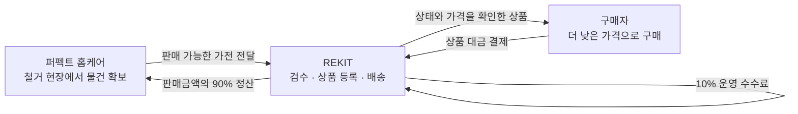

# REKIT 소개 · 철거 가전을 다시 연결하는 방식


REKIT은 철거 현장에서 나온 가전 중 다시 사용할 수 있는 물건을 검수해 상품으로 등록하고, 구매자에게 배송하는 재사용 가전 플랫폼이다. 퍼펙트 홈케어가 철거 현장에서 물건을 확보하면, REKIT이 판매 과정과 고객 경험을 맡는다.


## 한눈에 보는 거래 구조

* **상품 흐름**: 퍼펙트 홈케어 → REKIT → 구매자
* **돈의 흐름**: 구매자 → REKIT → 퍼펙트 홈케어
* **정산 구조**: REKIT은 판매금액의 \*\*10%\*\*를 수수료로 받고, 나머지 \*\*90%\*\*를 퍼펙트 홈케어에 정산한다.

## 누가 어떤 일을 하나요?

| 주체          | 역할                                                       |
| ----------- | -------------------------------------------------------- |
| **퍼펙트 홈케어** | 철거 과정에서 다시 사용할 수 있는 가전을 확보한다.                            |
| **REKIT**   | 물건 상태를 검수하고, 사진·설명·가격 정보를 갖춘 상품으로 등록한다. 주문 이후 배송까지 담당한다. |
| **구매자**     | 검수 정보를 확인한 뒤 필요한 가전을 더 합리적인 가격으로 구매한다.                   |

## 왜 더 낮은 가격이 가능한가요?

REKIT의 상품은 새 제품을 유통 경로에서 매입해 판매하는 방식이 아니다. 철거 현장에서 확보한 물건 가운데 다시 사용할 수 있는 제품을 선별해 판매한다. 그래서 새 제품 중심의 유통 비용과 재고 구조를 그대로 따르지 않아, 구매자에게 더 낮은 가격의 선택지를 제시할 수 있다.

다만 저렴한 가격만을 목표로 하지 않는다. 물건을 그대로 넘기는 대신 REKIT이 판매 전 검수, 상품 정보 작성, 주문 관리, 배송을 맡아 구매자가 중고 거래에서 느끼기 쉬운 불확실성을 줄인다.

## REKIT이 맡는 품질과 배송

REKIT은 판매 가능 여부를 확인한 뒤 상품을 등록한다. 구매자는 상품 페이지에서 상태와 정보를 확인하고, 주문한 뒤 REKIT을 통해 배송받는다.

이 구조에서 퍼펙트 홈케어는 철거 현장에서 확보한 물건이 다시 쓰일 수 있도록 연결하고, REKIT은 그 물건이 판매 가능한 상품이 되도록 관리한다. 구매자는 필요한 가전을 합리적인 가격에 구매하고, 아직 쓸 수 있는 물건은 폐기 대신 새로운 사용처를 찾는다.

## 정산 예시

판매금액이 100만 원인 상품이 판매되면 다음과 같이 정산한다.

| 구분         |     금액 | 내용                           |
| ---------- | -----: | ---------------------------- |
| 퍼펙트 홈케어 정산 |  90만 원 | 판매금액의 90%                    |
| REKIT 수수료  |  10만 원 | 검수·상품 등록·주문 관리·배송 운영을 위한 10% |
| 합계         | 100만 원 | 구매자가 결제한 판매금액                |

> REKIT은 철거 현장과 구매자를 연결하는 데서 끝나지 않는다. 다시 사용할 수 있는 가전을 검수하고, 이해하기 쉬운 상품 정보와 배송까지 책임져 재사용 거래가 실제 구매로 이어지게 만든다.
