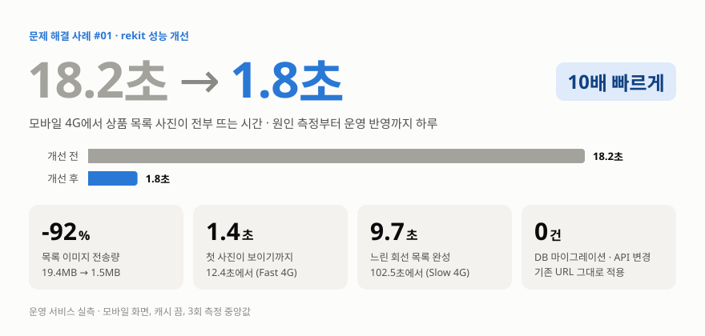
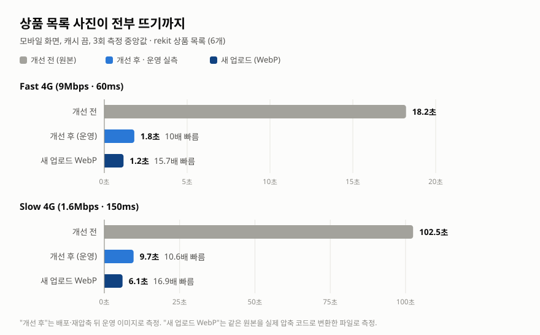

# 상품 이미지 로딩 18.2초 → 1.8초




**폰 원본 사진(장당 약 3MB)이 썸네일로 그대로 나가던 문제를 측정으로 찾아내, 하루 만에 운영 환경까지 수정을 반영했다.** Fast 4G 기준 상품 목록 로딩 **18.2초 → 1.8초 (10배)**, 이미지 전송량 **-92%**. DB 마이그레이션과 API 변경은 없었다.


## 30초 요약

<table><thead><tr><th width="89"></th><th></th></tr></thead><tbody><tr><td><strong>문제</strong></td><td>4G에서 상품 목록 사진이 모두 뜨기까지 <strong>18.2초</strong>, 첫 사진도 12.4초가 걸렸다</td></tr><tr><td><strong>원인</strong></td><td>브라우저가 스토리지에 직접 업로드하는 구조라 서버에서 사진을 줄일 단계가 없었다. 4000×3000 원본이 그대로 카드 썸네일로 쓰였다</td></tr><tr><td><strong>해결</strong></td><td>① 업로드 직전 브라우저에서 1600px WebP로 압축 ② 기존 이미지 일괄 재압축(백업·멱등·DB 수정 없음)</td></tr><tr><td><strong>결과</strong></td><td>운영 실측 <strong>18.2초 → 1.8초 (10배)</strong>, 느린 회선 <strong>102.5초 → 9.7초</strong>, 전송량 <strong>19.4MB → 1.5MB</strong></td></tr></tbody></table>

## 이 사례가 보여주는 것

* **측정이 먼저다**: "로딩 인디케이터를 붙이자"는 첫 아이디어 대신 무엇이 느린지부터 측정했다. 캐시를 끄고 회선 속도를 제한해 실제 사용자 환경을 재현했다
* **구조에서 원인을 찾는다**: 증상(느림)에 대응하는 대신 업로드 구조(presigned URL)에서 근본 원인을 찾았다
* **운영 데이터를 안전하게 바꾼다**: dry-run 측정 → 격리 경로에서 시험 → 백업 → 적용 → 바이트 단위로 결과 대조
* **예측과 실측이 일치한다**: 배포 전 예측 1.81초 = 운영 실측 1.81초

<table><thead><tr><th width="119">항목</th><th>내용</th></tr></thead><tbody><tr><td>프로젝트</td><td>rekit (업소용 중고가전 직거래 플랫폼), 1인 개발</td></tr><tr><td>기간</td><td>2026-11-13 (발견부터 운영 반영까지 하루)</td></tr><tr><td>역할</td><td>원인 측정, 프론트·백엔드 구현, 운영 데이터 마이그레이션, 배포</td></tr><tr><td>기술</td><td>Vue 3 · TypeScript · Canvas API · Python · Pillow · S3 API(SeaweedFS) · Puppeteer · Chrome DevTools Protocol</td></tr></tbody></table>

***

## 1. 문제

상품 목록과 상세 화면에서 사진이 늦게 떴다. 로딩 표시도 없어서 빈 카드만 보이다가 몇 초 뒤에야 사진이 툭 나타났다.

처음 떠올린 해결책은 "로딩 인디케이터를 붙이자"였다. 하지만 로딩 표시는 기다림을 견디게 해 줄 뿐, **기다리는 시간 자체를 줄이지는 못한다.** 그래서 무엇이 느린지부터 측정했다.

**발견 과정**

1. 개발자 도구 Network 탭에서는 이미지가 전부 `(disk cache)`로 표시돼 문제가 드러나지 않았다. 같은 페이지를 반복해서 여는 개발자 환경은 늘 캐시가 채워진 상태이기 때문이다.
2. **캐시를 끄고** 다시 불러오자 카드 이미지 한 장이 **2.5\~3.9MB**로 나타났다.


처음 방문한 사용자에게는 캐시가 없다. 성능은 **캐시를 끄고 회선 속도를 제한한 상태**에서 측정해야 실제 사용자 환경과 같아진다.


## 2. 기준선 — 수정 전 운영 실측

| 항목                       | 값                                              |
| ------------------------ | ---------------------------------------------- |
| 상품 / 이미지                 | 6개 / 12장                                       |
| 해상도                      | **12장 모두 4000×3000** (12MP 폰 원본)               |
| 장당 용량                    | 2.49 \~ 3.91MB                                 |
| 목록 썸네일 6장 합계             | **19,371,134 B (19.4MB)**                      |
| 메타데이터(EXIF)              | 12장 모두 포함, 그중 8장은 세로 회전 정보(`orientation=6`) 포함 |
| 12장 다운로드 시간 (`curl`, 2회) | 13.4초 / 34.7초 (장당 최대 8.9초)                     |

19.37MB를 9Mbps(Fast 4G)로 받는 이론 시간은 17.2초, 1.6Mbps(Slow 4G)로는 96.9초다. 실측값(18.2초, 102.5초)과 오차 6% 이내로 일치한다. **느린 원인의 거의 전부가 순수 전송량**이라는 근거다.

## 3. 원인

```
관리자 폰 사진 (4000×3000, 약 3MB)
   │  presigned URL로 브라우저 → 스토리지 직접 업로드 (서버를 거치지 않음)
   ▼
스토리지 ─ 원본 그대로 저장
   │  썸네일 = 첫 번째 이미지 URL 그대로
   ▼
목록 카드 (화면에서 약 200px) ← 4000px 원본이 그대로 내려감
```

1. **presigned URL 직접 업로드 구조**: 서버는 업로드 확인 단계에서 파일의 존재 여부와 형식만 검사했다. 파일 크기를 줄일 단계가 구조적으로 없었다.
2. **썸네일 부재**: API의 `thumbnail_url`은 별도로 만든 썸네일이 아니라 첫 번째 원본 이미지의 URL이었다.

## 4. 해결

<table><thead><tr><th width="71"></th><th>조치</th><th>대상</th><th>방법</th></tr></thead><tbody><tr><td>①</td><td>업로드 전 압축</td><td>앞으로 올라올 이미지</td><td>업로드 직전 브라우저에서 긴 변 기준 1600px, <strong>WebP(q0.82)</strong>로 재인코딩. WebP 미지원 브라우저에서는 JPEG로 자동 대체. 압축 결과가 원본보다 크면 원본 유지</td></tr><tr><td>②</td><td>기존 이미지 일괄 재압축</td><td>이미 올라간 이미지</td><td>Python 스크립트로 1600px JPEG(q82)로 재압축한 뒤 <strong>같은 키에 덮어쓰기</strong>. 기본 실행은 dry-run, 적용 전 원본 백업, 재실행해도 안전(멱등)</td></tr><tr><td>③</td><td>로딩 체감 개선</td><td>모든 상품 이미지</td><td>로딩 중 스켈레톤(shimmer) 표시, 로드 완료 시 fade-in, 사용자의 '동작 줄이기' 설정 존중</td></tr></tbody></table>

**왜 이 방법을 골랐나**

* **브라우저에서 줄인 이유**: 직접 업로드 구조를 그대로 유지할 수 있고, 서버에 부하를 더하지 않으면서 업로드 트래픽도 줄어든다. 관리자 업로드 용량도 장당 7.8MB에서 0.55MB로 줄어 업로드가 빨라졌다.
* **기존 이미지를 JPEG로 유지한 이유**: 저장 키가 `.jpg`로 끝나서 형식을 바꾸면 DB에 저장된 URL까지 바꿔야 한다. 같은 형식으로 덮어써 **DB 마이그레이션 없이** 마무리했다.
* **스피너 대신 스켈레톤**: 카드 그리드에 스피너가 여러 개 돌면 산만하고 오히려 더 느려 보인다.
* **EXIF 회전 처리**: canvas로 다시 그리면 EXIF가 사라져 세로 사진이 가로로 눕는다. 그래서 디코딩 단계에서 회전 정보를 먼저 픽셀에 반영했다 (`createImageBitmap(..., { imageOrientation: 'from-image' })`). canvas로 다시 그리는 과정에서 위치정보 같은 메타데이터도 함께 제거된다.

**운영 데이터에 안전하게 적용한 순서**

1. 변환 함수만 분리해 운영 원본 12장으로 검증: 크기·형식·회전, 재실행 시 건너뛰는지
2. 로컬 스토리지의 격리된 경로에서 전체 흐름 검증: 측정 → 백업 → 덮어쓰기 → 재실행 시 건너뛰는지
3. 운영 환경에서 dry-run으로 결과를 확인한 뒤 적용
4. 적용 후 운영 파일이 사전 검증 결과와 **바이트 단위로 같은지** 확인 (12/12 일치)

## 5. 결과 — 운영 실측



| 지표                |        개선 전 | 개선 후 (운영) |         변화 |
| ----------------- | ----------: | --------: | ---------: |
| 목록 썸네일 6장 용량      |      19.4MB | **1.5MB** | **-92.2%** |
| Fast 4G 첫 사진 표시   |       12.4초 |  **1.4초** |       9.1배 |
| Fast 4G 목록 전부 표시  |       18.2초 |  **1.8초** |  **10.1배** |
| Slow 4G 목록 전부 표시  |      102.5초 |  **9.7초** |      10.6배 |
| 12장 다운로드 (`curl`) | 13.4\~34.7초 |  **2.5초** |          — |

* 앞으로 새로 올라올 이미지(WebP)는 더 작다: 목록 용량 0.88MB(-95.5%), Fast 4G 목록 전부 표시 1.2초(15.7배)
* 배포 전 예측 1.81초와 운영 실측 1.81초가 일치했다

## 6. 측정 방법과 한계

| 항목     | 방법                                                                                                           |
| ------ | ------------------------------------------------------------------------------------------------------------ |
| 용량·해상도 | `curl`로 운영 파일 다운로드, Pillow로 해상도·EXIF 확인, md5로 결과 동일성 확인                                                      |
| 압축 결과  | 실제 배포 코드를 운영 원본 12장에 그대로 적용 (브라우저 압축은 헤드리스 Chrome에서, 재압축은 Python 스크립트로 실행)                                   |
| 로딩 시간  | Puppeteer로 모바일 화면(390×844, @2x)을 띄우고 캐시를 끈 상태에서 Chrome DevTools Protocol로 회선 제한. 회선 2종 × 이미지 3종 × 3회 측정한 중앙값 |


* 로딩 시간은 회선 에뮬레이션으로 잰 값이라 실제 이동통신망의 속도 변동은 반영되지 않는다. 다만 이론 전송 시간과 오차 6% 이내로 일치하므로 "병목은 전송량"이라는 결론은 유효하다.
* 모든 수치는 상품 6개 기준이다. 상품이 20개였다면 개선 전 목록 용량은 약 65MB에 달했을 것으로 **추정**된다.
* "새 업로드 WebP" 수치는 실제로 새로 업로드된 파일이 아니라, 같은 원본을 실제 압축 코드로 변환한 파일로 잰 값이다.


## 7. 배운 점

1. **로딩 표시보다 원인 측정이 먼저다.** 스켈레톤만 붙였다면 사용자는 18초 동안 반짝이는 빈 카드를 보고 있었을 것이다.
2. **개발자 화면은 캐시 덕분에 늘 빠르다.** 성능 문제는 캐시를 끄고 회선 속도를 제한해야 보인다.
3. **직접 업로드 구조에서는 서버가 파일 내용을 보지 못한다.** 압축이든 검사든, 보통 서버가 맡던 후처리를 누가 맡을지 따로 설계해야 한다.
4. **측정값을 이론값과 대조하면 측정 결과를 믿을 수 있다.**
5. **운영 데이터는 "dry-run 측정 → 격리 시험 → 백업 → 적용 → 결과 대조"** 순서로 다루면 롤백 걱정 없이 바꿀 수 있다.

## 다음 단계

* 카드 전용 480px 썸네일 별도 생성 (시뮬레이션 결과 장당 16\~25KB, 1600px WebP의 약 1/7)
* 이미지 응답에 장기 캐시 헤더(`Cache-Control: immutable`) 적용
