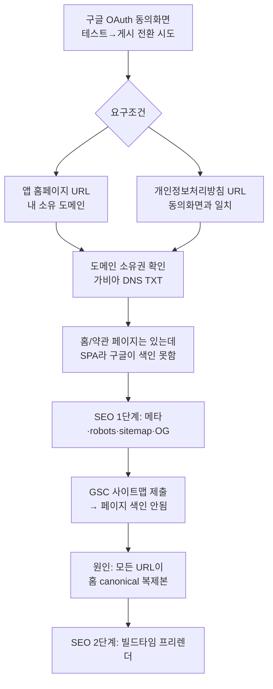

# 08.30 · 검색 노출 1·2단계 — 메타·사이트맵·프리렌더

> 💡 발단은 "구글 소셜 로그인 게시(테스트→프로덕션) 전환"이었는데, 그 과정에서 요구된 **앱 홈페이지 / 개인정보처리방침 URL** 조건을 맞추다가 → **SPA 검색 색인 문제**로 번져서 SEO 1·2단계를 진행함.
>
> 관련: 검색 노출 전략 - Search Console & 키워드 랭킹 · Nuxt SEO 메타태그와 noindex 전략

프로젝트: `rekit_client` (Vue 3 SPA) / 배포 도메인 **`rekit.co.kr`** (문서엔 `rekit.kr`로 잘못 적힌 곳 많음)

***

### 0. 전체 맥락 (왜 이 작업을 했나)



> 💡 **핵심 결론**
>
> * 구글 소셜 로그인 스코프가 `openid email profile` (**비민감**)이라 **구글 보안 검수는 불필요**. 동의화면 필드(홈페이지·개인정보처리방침 등)만 채우면 바로 게시 가능.
> * SPA는 정적 HTML이 전부 동일 → 구글이 모든 페이지를 "홈페이지 복제본"으로 보고 색인 거부 → **프리렌더가 필수**였음.

***

### 1. 도메인 소유권 확인 (가비아)

`rekit.co.kr`은 **가비아**에 등록 + 가비아 네임서버(`ns.gabia.co.kr`) 사용. 배포 서버 IP `<서버 공인 IP>` (Docker + nginx).

* Google Search Console → 도메인 속성 추가 → **DNS TXT 레코드** 방식
* 가비아: `My가비아 → DNS 관리툴 → rekit.co.kr 설정 → 레코드 추가`
  * 타입 `TXT` / 호스트 `@` / 값 `google-site-verification=...` / TTL 3600
* 반영 확인: `dig +short TXT rekit.co.kr`
* ⚠️ 인증 후 이 TXT 레코드 **삭제 금지** (지우면 소유권 상실 처리)

***

### 2. SEO 1단계 — 메타 / robots / sitemap / OG

> 커밋 `f1447ee` (메타·robots·sitemap), `e310860` (OG 이미지)

#### 2-1. `@unhead/vue` 도입 — 라우트별 메타

* `src/main.ts` 에 `createHead()` 플러그인 등록
*   **`src/composables/usePageSeo.ts`** (신규) — 헬퍼. 각 뷰에서 이렇게 호출:

    ```ts
    usePageSeo({
      title: '이용약관',
      description: 'rekit 서비스 이용약관...',
    })
    ```

    * `title` → `"이용약관 · rekit"` 로 접미사 자동 부착 (홈은 접미사 없음)
    * `canonical` → `https://rekit.co.kr` + 현재 경로 (상품목록은 필터 조합 무시하고 `/products` 고정)
    * OG / 트위터 카드 태그 전부 생성
* 적용된 뷰: 홈, 상품목록, 상품상세(상품명·가격 동적), 소개, 가이드, FAQ, 문의, 공지, 이용약관, 개인정보처리방침

#### 2-2. `index.html`

* `<html lang="">` → `lang="ko"`
* 기본 `description` / OG / `canonical` / `robots` 태그 추가 (프리렌더 안 되는 경로의 fallback 값)

#### 2-3. robots / sitemap

| 파일                          | 내용                                                                                         |
| --------------------------- | ------------------------------------------------------------------------------------------ |
| `public/robots.txt`         | 비공개 영역(`/admin` `/my` `/cart` `/checkout` `/auth` `/search` `/_design`) 차단 + `Sitemap:` 위치 |
| `public/sitemap.xml`        | 공개 URL 9개. **`scripts/gen-sitemap.mjs`가 빌드마다 자동 생성** (`lastmod` 갱신)                        |
| `scripts/public-routes.mjs` | 공개 라우트 목록 — sitemap과 prerender가 **공유** (한 곳만 고치면 됨)                                        |

#### 2-4. noindex 처리

* `src/App.vue` 에서 경로 기준 전역 처리: 비공개 프리픽스면 `robots: noindex, nofollow`
* `src/views/NotFoundView.vue` — 404는 개별적으로 `noindex`

#### 2-5. OG 공유 이미지

* **`public/og-cover.png`** (1200×630) — 카톡/슬랙/트위터 공유 시 미리보기 이미지
* **`scripts/gen-og.mjs`** 로 생성 (`@resvg/resvg-js` — SVG→PNG). 문구 바꾸려면 스크립트 수정 후 `npm run gen-og`
* 디자인: 잎사귀 로고 + "폐업 매장 영업용 가전 / 평균 73% 할인" + `rekit.co.kr`

***

### 3. SEO 2단계 — 빌드타임 프리렌더 (핵심)

> 커밋 `d652ff1`

#### 3-1. 왜 필요했나

GSC에 사이트맵 제출했더니 **"페이지 색인이 생성되지 않음"**.

원인: SPA fallback 때문에 `/legal/privacy`, `/products` 등 **어떤 주소로 들어와도 서버가 똑같은 `index.html`** 을 내려줌. 그 안의 `<link rel="canonical">` 이 전부 홈(`/`)을 가리킴. → 구글의 첫 크롤(JS 실행 전)에서 **모든 페이지 = 홈 복제본** 으로 판단 → 색인 거부. JS 실행 후 `usePageSeo`가 canonical을 고치지만, 구글은 렌더링을 나중으로 미루고 초기 신호로 판단함.

#### 3-2. 방식 선택

| 후보                      | 채택? | 이유                                              |
| ----------------------- | --- | ----------------------------------------------- |
| `vite-ssg`              | ❌   | `vue-router` 5 미지원 (공식 4까지). 엔트리 구조·스토어 SSR 리스크 |
| `vite-prerender-plugin` | ❌   | 결국 SSR 렌더링 필요 → 같은 리스크                          |
| **빌드 후 puppeteer 스냅샷**  | ✅   | **앱 코드 0줄 수정**. 실제 브라우저 번들을 그대로 렌더              |

#### 3-3. 동작 (`scripts/prerender.mjs`)

1. `vite build` 결과물(`dist/`)을 로컬 정적 서버로 띄움
2. puppeteer(헤드리스 크롬)로 공개 라우트 9개 각각 방문 → JS 실행 완료 대기
3. 렌더된 DOM(`page.content()`)을 파일로 저장:
   * `/` → `dist/index.html` (덮어씀)
   * `/about` → `dist/about/index.html` **및** `dist/about.html` (nginx 설정 편차 대응)
4. 브라우저 실행 실패 시 **graceful skip** (빌드는 안 깨지지만 프리렌더 효과는 없음)

`npm run build` → `gen-sitemap` → `vite build` → `prerender` 순서로 실행됨. 우회: `SKIP_PRERENDER=1 npm run build`

#### 3-4. 배포 인프라 수정 (같이 건드려야 했던 것)

* **`Dockerfile`**: 빌드 스테이지가 `node:22-alpine` 인데 puppeteer 번들 크롬은 musl에서 안 돌아감 → `apk add chromium` + `PUPPETEER_SKIP_DOWNLOAD=1` + `PUPPETEER_EXECUTABLE_PATH=/usr/bin/chromium-browser`
* **`nginx.conf`**: `try_files $uri $uri/ /index.html` → **`try_files $uri $uri.html $uri/index.html /index.html`**
  * 기존: `/about` → 301 리다이렉트 → `/about/` (canonical과 불일치)
  * 변경 후: `/about` → `dist/about.html` **직접 서빙, 리다이렉트 없음** (canonical/sitemap URL과 정확히 일치)

#### 3-5. 검증 (로컬 Docker 빌드로 확인함)

```
/about          [200] <title>rekit 소개 · rekit</title>          ← 프리렌더 ✅
/legal/privacy  [200] <title>개인정보처리방침 · rekit</title>     ← 프리렌더 ✅
/products       [200] <title>전체 상품 · rekit</title>            ← 프리렌더 ✅
/my/orders      [200] <title>rekit · 폐업 가전...</title>         ← SPA fallback (비공개, 정상)
/products/p1    [200] (홈 HTML fallback → JS가 상세로 전환)        ← 동적, 프리렌더 대상 아님
```

***

### 4. 변경/생성된 파일 요약

#### 신규

* `src/composables/usePageSeo.ts` — 라우트별 메타 헬퍼
* `scripts/public-routes.mjs` — 공개 라우트 목록 (공유)
* `scripts/gen-sitemap.mjs` — sitemap 생성
* `scripts/gen-og.mjs` — OG 이미지 생성
* `scripts/prerender.mjs` — 프리렌더
* `public/robots.txt`, `public/sitemap.xml`, `public/og-cover.png`

#### 수정

* `index.html` — lang, 기본 메타
* `src/main.ts` — unhead 플러그인
* `src/App.vue` — 전역 noindex 처리
* `src/views/**` 10개 — `usePageSeo()` 호출 추가
* `package.json` — `@unhead/vue` (dep), `@resvg/resvg-js`·`puppeteer` (devDep), `gen-sitemap`/`gen-og`/`prerender` 스크립트
* `Dockerfile` — chromium
* `nginx.conf` — try\_files
* `todo.md` — SEO 항목 갱신

#### 커밋

* `f1447ee` seo: 라우트별 메타·robots·sitemap 추가 (1단계)
* `e310860` seo: OG 공유 이미지 추가
* `d652ff1` seo: 공개 페이지 빌드타임 프리렌더 (2단계)

***

### 5. 남은 작업 (배포 후 수동)

* [ ] **Jenkins 재빌드/배포** — `build-client` → `deploy-client` (IMAGE\_TAG = 새 short sha). 새 이미지에 프리렌더 반영
* [ ] 배포 검증: `curl -s https://rekit.co.kr/about | grep '<title>'` → `rekit 소개` 나와야 성공
* [ ] **구글 OAuth 동의화면 게시** — 홈페이지 `https://rekit.co.kr/`, 개인정보처리방침 `https://rekit.co.kr/legal/privacy`. 로고 업로드했으면 제거 검토(브랜드 검수 트리거)
* [ ] **GSC**: 사이트맵 재크롤 요청 + `/` URL 검사 → 색인 요청. 나머지는 사이트맵 통해 자동 (며칠\~2주)
* [x] \~\~`www.rekit.co.kr` → 루트 301\~\~ → **가비아 DNS에서 www 레코드 제거로 대체 해결** (2026-08-30). 배경: www에서 시작한 소셜 로그인이 apex 콜백으로 튕겨 state 검증 실패 → [08.30 일지](https://jineuns-tech.gitbook.io/jineuns-tech-docs/rekit/2026-08/2026-08-30) §6
* [ ] `docs/api.md` 등 `rekit.kr` → `rekit.co.kr` 참조 정리
* [ ] **3단계**: JSON-LD 구조화 데이터 (`Organization` 홈, `Product` 상품상세), 상품 상세 프리렌더 (백엔드 연동 후)

***

### 6. 유지보수 메모

> ✅ **공개 페이지를 새로 추가하면**
>
> `scripts/public-routes.mjs` 의 `PUBLIC_ROUTES` 배열에 경로 추가 → sitemap·prerender 둘 다 자동 반영. 해당 뷰에 `usePageSeo({ title, description })` 호출 추가.

> ✅ **OG 이미지 문구 변경**
>
> `scripts/gen-og.mjs` 수정 → `npm run gen-og` → `public/og-cover.png` 갱신 후 커밋.

> ⚠️ **프리렌더가 배포에 안 먹힐 때**
>
> 1. Docker 빌드 로그에 `prerender: 9/9 라우트 완료` 뜨는지 확인. `브라우저 실행 실패` 뜨면 alpine chromium 문제.
> 2. `curl https://rekit.co.kr/about` 이 301 뱉으면 `nginx.conf` 의 `try_files` 가 옛날 버전.
> 3. GSC "크롤링됨 - 색인 안됨" 이 계속되면 콘텐츠 빈약(thin content) 문제일 수 있음 — 실제 상품 데이터(백엔드) 붙기 전까진 한계.

