# 문제와 배경


**핵심 — 쇼핑몰은 돌고 있었지만, 운영 서버 안에서 무슨 일이 일어나는지 볼 방법이 없었다.**


## 사건 — INFO 로그가 한 줄도 남지 않았다 (11.05)

2026년 11월 5일, 운영 로그를 확인하다가 앱의 INFO 로그가 운영에서 전부 버려지고 있었다는 것을 발견했다. "토스 웹훅 수신", "방치 주문 N건 정리" 같은 결제·주문 기록이 첫 배포(08.23)부터 한 번도 남지 않았다.

원인은 설정 한 줄이 없었던 것이다. 앱 어디에도 로깅 초기화가 없어서, 모든 로그가 Python 기본값인 root 로거(레벨 WARNING, 핸들러 0개)로 갔다. gunicorn 은 자기 로거만 설정하므로 앱 로그는 대상이 아니다.



_root 로거가 WARNING 미만을 버리고, 핸들러가 없으니 WARNING 이상도 형식 없이 stderr 로만 나갔다. 문제는 오류가 아니라 "아무 일도 안 일어난 것처럼 보이는" 상태였다는 점이다 — 결제 수동 테스트의 "로그에 ~가 찍히는지" 항목이 처음부터 확인할 수 없는 항목이었다._

## 같은 날 함께 나온 것

로그 하나를 따라가자 비슷한 빈자리가 줄줄이 나왔다.

| 발견 | 그대로 두면 생기는 일 |
| --- | --- |
| 로그 로테이션 없음 (json-file 무제한) | 로그가 서버 디스크를 채울 수 있다 — DB 와 사진도 같은 서버에 있다 |
| `/health` 가 DB·Redis 를 보지 않고 항상 ok | DB 가 죽어도 헬스체크는 정상으로 보인다 |
| `structlog` 는 의존성에만 있고 사용처 0곳 | 로그가 사람이 읽는 문장이라 검색·집계가 어렵다 |
| 롤백하면 기동 실패 (이미지와 compose 시점 불일치) | 장애 때 되돌리는 수단이 오히려 장애를 만든다 |

_근거: 11.05 일지 §1·§7, 커밋 `27ddb68` `ec02f66`_

## 왜 이때 드러났는가

rekit 은 폐업 매장에서 나온 업소용 가전을 파는 쇼핑몰이고, 한 사람이 화면·서버·운영을 모두 맡는다. 5월에 개발을 시작해 8월 23일 첫 운영 배포를 했고, 9~10월에는 토스 결제 연동과 첫 실제 매물 판매가 이어졌다.

그동안 운영 확인은 배포한 뒤 화면에서 직접 눌러 보는 방식이었다(08.23 일지 "확인은 실제 배포로 했다"). 11월 1일 서버 전체를 다시 분석한 문서에서 "서버 안에서 무슨 일이 일어나는지 볼 수 있는 장치가 없다"는 항목이 나왔고, 나흘 뒤 그 항목을 손대자마자 위 사건이 드러났다.

```
05.01  개발 시작 ──── 08.23  첫 운영 배포 ──── 10.16  첫 실제 결제 ──── 11.01  전체 분석 ──── 11.05  로그 유실 발견
       (개발 PC)            (서버 1대)                (토스)                "볼 장치가 없다"          → 관측성 작업 시작
```

## 이 문서가 다루는 질문

이 사건 이후의 작업은 세 질문으로 정리된다. 나머지 장은 이 질문에 대한 답이 어떻게 지금 구조가 되었는지를 보여 준다.

| 질문 | 다루는 장 |
| --- | --- |
| 바깥에서 닿는 지점은 어디까지인가 | [시스템 구성](04-architecture/README.md), [주요 설계 결정](05-decisions.md) |
| 돈과 재고가 틀리지 않는다는 것을 무엇이 보장하는가 | [앱 구조와 결제](04-architecture/app.md) |
| 문제가 생기면 언제, 어떻게 알게 되는가 | [모니터링](04-architecture/monitoring.md), [운영 현황](08-operations.md) |
