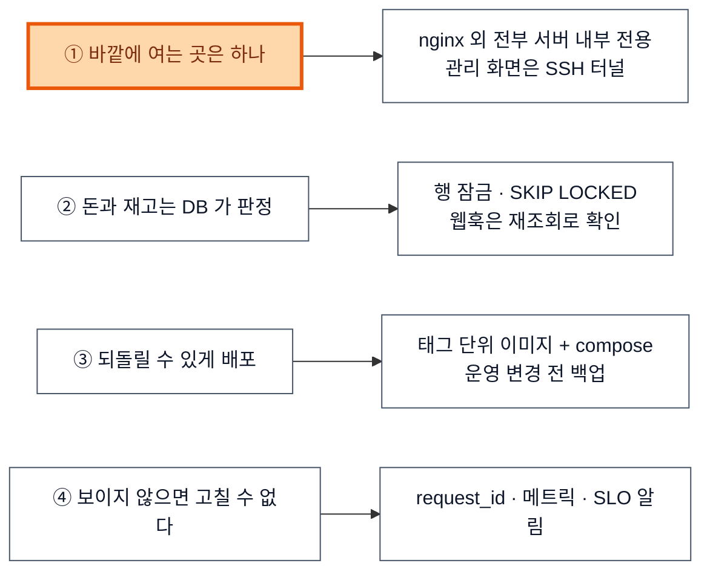

# 핵심 설계 원칙


**핵심 — 네 가지 원칙은 미리 정한 것이 아니라, 사고와 발견을 겪으며 하나씩 굳어진 것이다.**


_원칙마다 오른쪽에 실제로 바뀐 것을 붙였다. 원칙만 있고 적용 사례가 없는 항목은 이 목록에 넣지 않았다._

## ① 바깥에 여는 곳은 하나

인터넷에서 닿는 컨테이너는 nginx 하나다. 나머지 포트는 모두 서버 내부 전용으로 묶고, 관리 화면은 SSH 터널이나 nginx 의 HTTPS 경로로만 연다.

이 원칙은 11.10 점검에서 SeaweedFS 관리 포트가 외부에서 응답하는 것을 발견한 뒤 굳어졌다. Docker 의 포트 publish 는 호스트 방화벽(ufw) 규칙보다 앞서 적용되므로, 방화벽이 아니라 compose 파일의 바인딩 주소로 막는다.

| 대상 | 접근 수준 |
| --- | --- |
| nginx | 외부 공개 (HTTPS) |
| rekle-app · rekle-postgres · registry · Prometheus · Alertmanager · Grafana · Jenkins · SeaweedFS | 서버 내부 전용 |
| rekle-redis · exporter · rekle-web | 포트 publish 없음 (Docker 망 안에서만) |

## ② 돈과 재고는 DB 가 판정한다

재고 1개짜리 상품에 두 요청이 동시에 오면, 누가 이기는지는 DB 행 잠금이 정한다. 앱 메모리나 외부 메시지가 아니라 PostgreSQL 트랜잭션 안에서 재고를 줄이고 주문을 만든다.

외부에서 들어오는 결제 정보도 같은 원칙을 따른다. 토스 웹훅 본문은 상태 전이에 쓰지 않고, 받자마자 토스 결제 조회 API 로 다시 확인한 값으로만 주문 상태를 바꾼다.

| 상황 | 판정 방법 | 근거 |
| --- | --- | --- |
| 같은 상품을 동시에 주문 | 상품 행을 id 순서로 잠금 (데드락 방지) | 11.10 `6081921` |
| 결제 승인과 주문 취소가 동시에 | 같은 상품이 두 번 팔리는 경우를 테스트로 재현한 뒤 막음 | 10.16 |
| 방치 주문을 워커 4개가 동시에 정리 | `FOR UPDATE SKIP LOCKED` 로 한 건씩 가져감 | `abandoned_order_sweeper.py` |
| 웹훅 위조·순서 뒤바뀜 | 결제 조회 재확인 + 금액 대조 | 08.31, 09.04 |

## ③ 되돌릴 수 있게 배포한다

배포 단위는 git 태그(`X.Y.Z`)다. 이미지뿐 아니라 compose 파일도 그 태그 시점의 것을 꺼내 쓰기 때문에, 이전 태그를 고르면 실행 명령까지 함께 되돌아간다.

운영 서버의 설정 파일(nginx · SeaweedFS · Jenkins)은 레포 밖이라 git 기록이 없다. 그래서 바꾸기 전에 항상 날짜가 붙은 백업 파일을 남기고, 데이터가 걸린 변경은 데이터 백업부터 한다.

## ④ 보이지 않으면 고칠 수 없다

11.05 의 로그 유실은 "오류가 없는 것처럼 보이는 상태"가 가장 위험하다는 것을 보여 줬다. 그 뒤로 요청 하나를 nginx 부터 DB 까지 같은 `request_id` 로 추적할 수 있게 했고, 사용자 영향 기준(SLO)으로 알림을 정했다.

| 질문 | 답하는 장치 |
| --- | --- |
| 지금 얼마나 심각한가 | Prometheus 메트릭 · 알림 16개 · SLO 5개 |
| 이 요청에 정확히 무슨 일이 있었나 | JSON 로그 + `request_id` (nginx · 앱 공통) |
| 어디서 느려졌나 | 이벤트 루프 지연 · DB 풀 대기 · 외부 호출 시간 메트릭 |
| 서버가 통째로 멈추면 | `[아직 없음 — 서버 밖 업타임 감시, 회고 참고]` |
