# 시스템 구성


**핵심 — 서버 1대 위의 컨테이너들은 주요 Docker 망 4개로 나뉘고, 바깥과 닿는 지점은 nginx 하나다.**


## 범례

_색 영역은 Docker 망, 상자 색은 공개 수준, 선 모양은 흐르는 것의 종류다. 한 컨테이너가 여러 망에 붙어 있으면 대표 망 하나에 그리고 상자 안에 나머지 망 이름을 적는다._

## 이 장의 그림

| 페이지 | 그림이 답하는 질문 |
| --- | --- |
| [전체 구성](overview.md) | rekit 은 무엇과 연결되어 있는가 |
| [컨테이너와 네트워크](containers.md) | 어떤 컨테이너가 어느 망에서 서로 닿고, 무엇이 밖에 열려 있는가 |
| [요청 흐름](request-flow.md) | 요청 하나의 로그를 nginx 와 앱에서 어떻게 같은 ID 로 찾는가 |
| [앱 구조와 결제](app.md) | 앱 안에서 요청은 어떤 층을 지나고, 결제 한 건은 어떻게 확정되는가 · 배포는 어떤 길로 가는가 |
| [모니터링](monitoring.md) | 숫자 · 로그 · 운영자 접근은 각각 어디로 흐르는가 |


**공개 범위** — 이 문서에는 포트 번호, 서버 주소, 내부 관리 경로를 적지 않는다. 대신 "외부 공개 / 서버 내부 전용" 수준만 표시한다.

