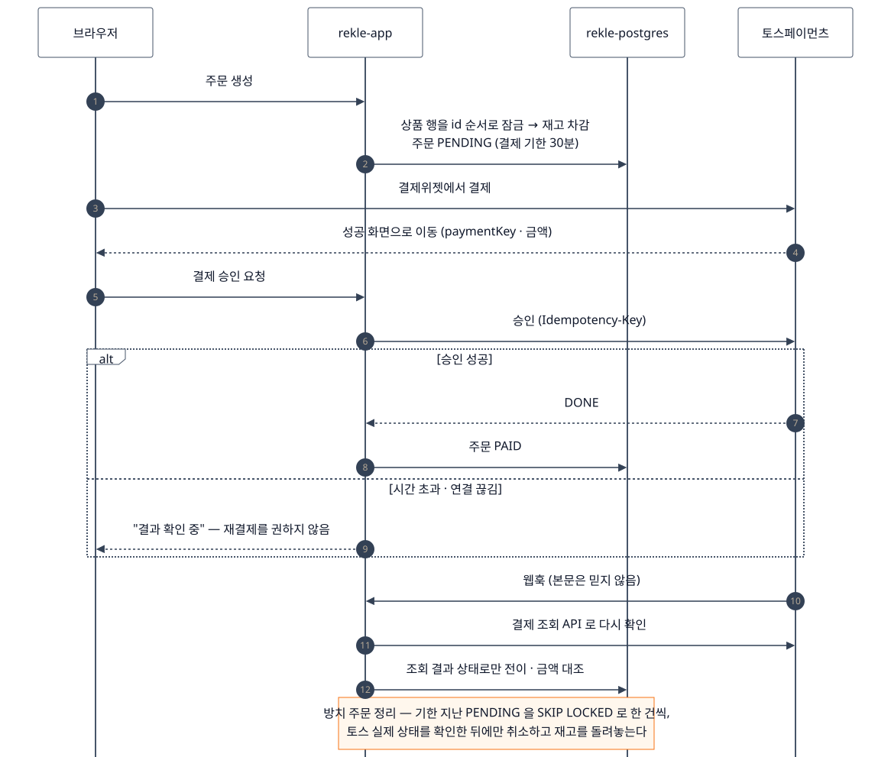

# 앱 구조와 결제


**핵심 — 앱은 하나로 배포하되 안에서는 도메인별로 나누고, 외부 서비스는 인터페이스 뒤에 두어 테스트에서 가짜로 바꿔 끼운다.**


## 층 구조

_외부 서비스만 port 뒤로 숨긴 이유는 테스트 때문이다. 토스 · 소셜 로그인 · 문자 · 메일을 실제로 부르지 않고도 결제 서비스 로직을 검증하려면, 서비스가 SDK 가 아니라 Protocol 에만 의존해야 한다. DB 접근은 같은 이유로 숨기지 않았다 — 쿼리 정확성과 잠금은 실제 PostgreSQL 통합 테스트로 확인한다._

| 규칙 | 이유 |
| --- | --- |
| `router → service → repository → models` 한 방향 | 트랜잭션 경계를 service 한 곳에 둔다 |
| router 가 repository 를 직접 부르지 않는다 | 도메인 규칙을 건너뛰는 경로를 만들지 않는다 |
| service 는 외부 시스템을 port(Protocol) 로만 부른다 | 테스트에서 `dependency_overrides` 로 fake 를 끼운다 |
| 모듈끼리 모델을 직접 import 하지 않는다 (타입 검사용 제외) | 순환 import 를 막고 모듈 경계를 유지한다 |

_근거: 저장소 `CLAUDE.md` "모듈 의존성 규칙", 05.05 일지 "외부 서비스를 갈아 끼울 수 있게 틀을 잡았다"_

## 도메인 모듈

| 모듈 | 맡는 것 | 외부 port |
| --- | --- | --- |
| `auth` | 가입 · 로그인 · 토큰 · 소셜 로그인 · 휴대폰 확인 | OAuth 3사 · Octomo |
| `user` | 프로필 · 탈퇴 익명화 · 관리자 회원 관리 | |
| `catalog` | 상품 · 카테고리 · 검색 | |
| `cart` · `favorites` · `address` | 장바구니 · 찜 · 배송지 | |
| `order` | 주문 · 배송 · 방치 주문 정리 | |
| `payment` | 결제 준비 · 승인 · 웹훅 · 취소 | PaymentGateway (토스) |
| `help` | 공지 · FAQ · 1:1 문의 | |
| `admin` | 대시보드 · 매출 집계 | |
| `common` | 사진 업로드 · 메일 | Storage (S3) · Email (Gmail) |

## 결제 한 건의 흐름

_결제는 세 곳(브라우저 · 토스 · 웹훅)에서 신호가 오므로, 어느 신호도 혼자서 주문 상태를 정하지 못하게 했다. 승인은 Idempotency-Key 로 한 번만 가게 하고, 웹훅은 결제 조회로 다시 확인하고, 아무 신호도 오지 않은 주문은 30분 뒤 스위퍼가 토스 실제 상태를 보고 정리한다._

| 단계 | 어긋날 수 있는 것 | 막는 방법 | 근거 |
| --- | --- | --- | --- |
| 주문 생성 | 재고 1개를 두 명이 동시에 | 상품 행을 id 순서로 잠근 뒤 차감 | 07.06, 11.10 `6081921` |
| 승인 요청 | 같은 승인이 두 번 | `Idempotency-Key` | 10.02 |
| 승인 응답 | 시간 초과로 결과를 모름 | "거절"과 "결과 모름"을 다른 오류로, 재결제 권유 안 함 | 07.07 |
| 웹훅 | 위조 · 순서 뒤바뀜 · 금액 불일치 | 결제 조회 API 로 재확인한 상태로만 전이, 금액 대조 | 08.31, 09.04 |
| 결제창 이탈 | 재고를 잡은 채 방치 | 기한 지난 PENDING 을 `SKIP LOCKED` 로 한 건씩, 토스 상태 확인 뒤 취소 | 10.16 |
| 취소 · 환불 | 주문만 취소되고 카드 결제는 그대로 | 주문 취소 때 토스 결제 취소 API 호출 | 09.04 |

주문 상태는 7가지다: `PENDING` → `PAID` → `PREPARING` → `SHIPPING` → `DELIVERED`, 그리고 `CANCELLED` · `REFUNDED`.

## 배포

_빌드와 배포를 두 잡으로 나눈 이유는 배포 버튼을 운영자가 직접 누르게 하기 위해서다. 배포 잡은 태그 하나를 입력받고, 그 태그 시점의 compose 파일을 같이 꺼내 이미지와 실행 명령이 늘 같은 시점이 되게 한다. 롤백도 같은 잡에서 이전 태그를 고르는 것으로 끝난다._

| 항목 | 값 |
| --- | --- |
| 배포 단위 | git 태그 `X.Y.Z` (형식이 틀리면 잡이 멈춘다) |
| 이미지 보관 | 서버 안 registry — 외부 이미지 저장소를 쓰지 않는다 |
| 운영 비밀 설정 | 레포에 없다. 서버의 정해진 위치에서 배포 때만 복사하고 끝나면 지운다 |
| DB 변경 | 앱 컨테이너가 시작할 때 `alembic upgrade head` 부터 실행 |
| 헬스체크 | 컨테이너는 `/health`(프로세스 생존)만 본다 — DB 장애 때 앱까지 재시작을 반복하지 않게. DB · Redis 확인은 `/health/ready` |
| 종료 | `exec gunicorn` 으로 셸을 대체해 종료 신호가 gunicorn 에 바로 간다 — 처리 중 요청을 끝낼 시간을 확보 |
