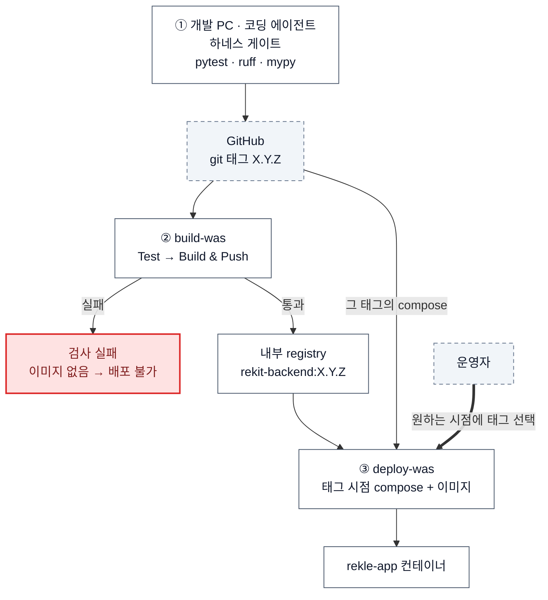
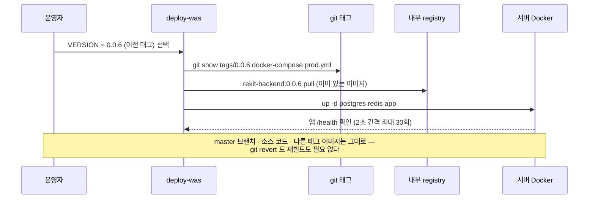
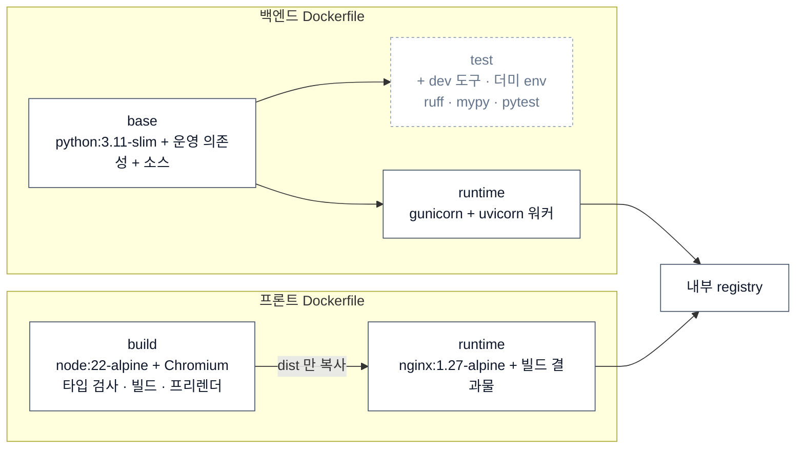
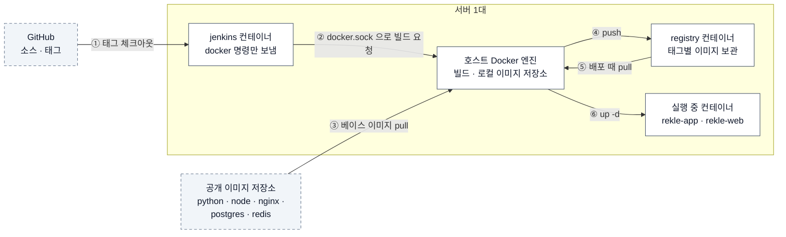

# 빌드와 배포 (CI/CD)


**핵심 — 검사 · 빌드 · 배포를 세 단계로 나눴다. 검사를 통과한 태그만 이미지가 되고, 그 이미지를 언제 띄울지와 어느 태그로 되돌릴지는 운영자가 고른다.**


## 전체 흐름

_세 단계로 나눈 이유는 각 단계가 막는 것이 다르기 때문이다. ①은 코드를 쓰는 순간의 실수를, ②는 검사를 건너뛴 태그가 이미지가 되는 것을 막는다. ③은 "언제 바꿀지"를 사람이 정하게 남겨 둔다. ②와 ③ 사이를 잇는 것은 사람의 확인이 아니라 "registry 에 그 태그의 이미지가 있는가" 하나다._

| 단계 | 무엇이 | 언제 | 실패하면 |
| --- | --- | --- | --- |
| ① 하네스 게이트 | 코딩 에이전트가 작업을 끝내기 전에 `pytest` · `ruff` · `mypy` 를 app 전체 기준으로 실행 (`CLAUDE.md` 규칙) | 작업 완료 직전 | 작업을 완료로 표시하지 않는다 |
| ② 빌드 파이프라인 `build-was` | 태그 체크아웃 → **Test**(ruff · mypy · 단위 테스트) → 운영 이미지 빌드 → 내부 registry 에 push | 운영자가 태그를 골라 실행 | 잡이 멈추고 이미지가 push 되지 않는다 |
| ③ 배포 파이프라인 `deploy-was` | 태그 시점 compose 꺼내기 → 이미지 pull → `up -d` → 헬스체크 | 운영자가 태그를 골라 실행 | 이전 태그로 같은 잡을 다시 실행 |


**CI 와 CD 의 범위** — 검사(①②)는 자동으로 돌지만, 파이프라인을 시작하는 것은 사람이다. push 하면 자동으로 빌드되는 웹훅이 없고, 배포도 버튼을 눌러야 한다. 그래서 CD 는 "지속적 배포(Deployment)"가 아니라 "언제든 배포 가능한 상태 유지(Delivery)"에 가깝다.


_근거: 백엔드 `Jenkinsfile.build` · `Jenkinsfile.deploy` · `Dockerfile`, 프론트 `Jenkinsfile.build` · `Jenkinsfile.deploy` · `Dockerfile`, 커밋 `397f85a`(빌드 · 배포 분리) · `ec02f66`(태그 시점 compose) · `2108861`(빌드 테스트 게이트)_

## 빌드와 배포를 나눈 이유

| 장점 | 어떻게 가능한가 | 실제 사례 |
| --- | --- | --- |
| **배포 시점을 고를 수 있다** | 빌드는 태그를 올린 직후에 해 두고, 배포는 운영자가 원하는 시간에 누른다 | Postgres 실행 옵션이 바뀐 0.0.6 은 DB 컨테이너가 다시 만들어져 수 초~수십 초 끊긴다 — 계획서에 "트래픽이 적은 시간 · 직전 백업 후 배포"를 적어 두고, 코드 머지와 별개로 밤 시간에 배포했다 (11.10) |
| **소스를 되돌리지 않고 이미지만 롤백한다** | registry 에 태그별 이미지가 남아 있어, 이전 태그를 고르면 다시 빌드하지 않고 그 이미지를 띄운다. master 브랜치에는 손대지 않는다 | 09.04 태그 기준 배포로 바꾼 날, 0.0.2 빈 버전으로 되돌리기를 시험했다 |
| **실행 명령까지 함께 롤백한다** | 이미지뿐 아니라 compose 도 그 태그 시점 파일을 쓴다 | master 의 실행 명령으로 옛 이미지를 띄우면 기동이 실패하던 문제를 11.05 에 고쳤다 ([주요 설계 결정 4](../05-decisions.md)) |
| **빌드 실패가 운영에 닿지 않는다** | 빌드가 깨져도 실행 중인 컨테이너와 registry 의 기존 태그는 그대로다 | — |
| **검사를 건너뛴 이미지가 생기지 않는다** | Test 단계가 Build & Push 앞에 있어, 실패하면 registry 에 그 태그가 없다 → 배포할 이미지가 없다 | 11.17 브랜치에 추가, 운영 Jenkins 적용 전 |

### 롤백 한 번에 일어나는 일

_롤백을 "이전 태그로 배포"와 같은 동작으로 만든 이유는, 장애 중에는 새 절차를 떠올릴 여유가 없기 때문이다. 평소 배포에 쓰는 버튼 하나가 롤백도 한다._


**이미지 롤백으로 되돌아가지 않는 것 — DB 스키마.** 앱 컨테이너는 시작할 때 `alembic upgrade head` 를 실행한다. 새 태그에서 컬럼을 지우거나 바꾸는 변경을 적용한 뒤 이전 이미지로 되돌리면, 스키마는 새 상태로 남는다. 그래서 이미지 롤백은 DB 변경이 이전 코드와도 호환될 때만 안전하다. `[확인 필요: 호환되지 않는 DB 변경의 배포 규칙 — 문서화된 규칙 없음]`


## 사용하는 Docker 이미지

### 이미지를 만드는 단계 (Dockerfile)

_검사 단계와 운영 단계를 같은 Dockerfile 안의 다른 단계로 둔 이유는, 검사한 소스와 운영 이미지의 소스가 같은 `base` 에서 나오게 하기 위해서다. 검사 도구와 테스트용 더미 설정은 `test` 단계에만 있고, registry 로 가는 `runtime` 에는 들어가지 않는다 (점선 상자는 registry 에 올라가지 않는 이미지)._

| 이미지 | 베이스 | 들어 있는 것 | registry 에 올라가나 |
| --- | --- | --- | --- |
| 백엔드 `test` 단계 | `base` | 운영 의존성 + dev 도구(pytest · ruff · mypy) + 테스트 전용 더미 env | 아니다 — 빌드 후 삭제 |
| `rekit-backend:X.Y.Z` | `base` (python:3.11-slim) | 앱 소스 · 운영 의존성 · gunicorn 설정 | 예 |
| 프론트 `build` 단계 | node:22-alpine | Node · Chromium(프리렌더용) · 소스 | 아니다 — 결과물만 다음 단계로 |
| `rekit-client:X.Y.Z` | nginx:1.27-alpine | 빌드된 정적 파일 · nginx 설정 | 예 |

### registry 를 거치지 않는 이미지

| 이미지 | 쓰는 곳 | 받는 곳 |
| --- | --- | --- |
| postgres:15-alpine · redis:7-alpine | 앱 compose 의 DB · Redis | 공개 이미지 저장소에서 직접 pull |
| prometheus · alertmanager · grafana · exporter 4종 | 관측 compose (버전 고정) | 공개 이미지 저장소에서 직접 pull |
| nginx · SeaweedFS · Jenkins · registry · certbot | 서버에 먼저 있던 컨테이너 | 레포 밖에서 관리 `[확인 필요: 각 이미지 버전]` |

## 이미지가 이동하고 저장되는 경로

_이미지를 서버 밖으로 내보내지 않는 이유는, 빌드 · 보관 · 실행이 모두 같은 서버에서 끝나 외부 이미지 저장소 계정이 필요 없기 때문이다(08.23). 빌드는 Jenkins 컨테이너 안이 아니라 호스트 Docker 엔진에서 일어난다 — Jenkins 는 Docker 소켓으로 명령만 보낸다._

| 번호 | 이동 | 저장 위치 | 남는 기간 |
| --- | --- | --- | --- |
| ① | GitHub → Jenkins 작업 공간 | Jenkins 작업 공간 (태그 체크아웃) | 다음 빌드까지 |
| ②③ | 빌드 → 호스트 Docker 엔진 | 호스트의 로컬 이미지 저장소 | 배포 잡의 `docker image prune -f` 가 이름 없는 이미지를 지운다 |
| ④ | 호스트 → 내부 registry | registry 컨테이너의 저장 볼륨 (서버 내부 전용) | 지우는 규칙 없음 — 모든 태그가 남는다 `[확인 필요: registry 용량 · 보관 정책]` |
| ⑤⑥ | registry → 호스트 → 컨테이너 | 실행 중 컨테이너 | 다음 배포까지 |
| — | 운영 비밀 설정 | 서버의 정해진 위치. 배포 잡이 실행할 때만 작업 공간으로 복사하고 끝나면 지운다 | 배포 중에만 |


**태그별 이미지가 모두 남는 것이 롤백의 전제다.** 이전 태그로 즉시 되돌릴 수 있는 이유는 registry 에 그 이미지가 그대로 있어서다. 대신 정리 규칙이 없어 태그가 쌓일수록 registry 볼륨이 커진다 — 디스크 사용률 알림(80% · 90%)이 마지막 안전장치다.


## 백엔드와 프론트의 차이

| | 백엔드 | 프론트 |
| --- | --- | --- |
| 빌드 잡 · 배포 잡 | `build-was` · `deploy-was` | `build-client` · `deploy-client` |
| 빌드 안 검사 | ruff · mypy · 단위 테스트 (Test 단계) | 타입 검사 (`npm run build` 에 포함), lint 는 빌드에서 돌지 않음 |
| 빌드 시점에 넣는 값 | 없음 — 비밀 설정은 배포 때 | 소셜 로그인 공개 ID (서버의 비밀 설정 파일에서 읽어 빌드 인자로) |
| 빌드가 기대는 외부 | 공개 이미지 저장소 | + 운영 API (프리렌더가 빌드 중 실제 API 를 부른다 — 11.15 프리렌더 사례의 원인) |
| 배포 때 다시 만드는 컨테이너 | postgres · redis · app | web |

## 남은 과제

| 과제 | 왜 |
| --- | --- |
| 빌드 테스트 게이트 첫 실행 검증 | 11.17 브랜치에 추가했고, 운영 Jenkins 에서 아직 실행하지 않았다 |
| 통합 테스트를 빌드 게이트에 포함 | 지금 게이트는 실제 PostgreSQL · Redis 가 필요한 테스트를 뺀다. 빌드 때 테스트용 DB 컨테이너를 잠깐 띄워야 한다 |
| 프론트 빌드에 lint 추가 | 지금은 타입 검사만 돈다 |
| push 하면 빌드가 자동으로 시작 | 빌드를 사람이 눌러야 해서, 태그를 올리고 빌드를 잊으면 배포 시점에 기다려야 한다 |
| registry 정리 규칙 | 최근 N개 태그만 남기는 식의 규칙이 없다 |
| 호환되지 않는 DB 변경의 배포 규칙 | 이미지 롤백이 스키마를 되돌리지 않는다 |
| 관측 스택 배포 자동화 | 지금은 레포에서 서버로 손으로 복사한다 |
