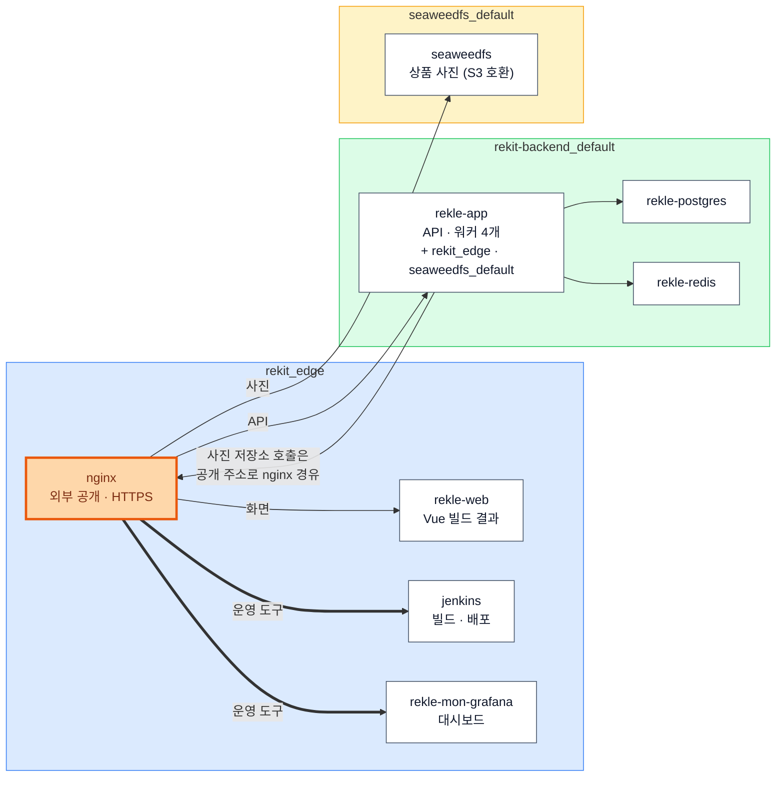

# 컨테이너와 네트워크


**핵심 — 컨테이너가 서로 닿는 범위는 Docker 망이 정하고, 바깥에 열리는 범위는 포트 바인딩이 정한다. 두 가지를 따로 관리한다.**




_DB 와 Redis 는 `rekit-backend_default` 에만 두어, 바깥은 물론 nginx 도 직접 닿지 못하게 했다. `rekle-app` 은 세 망에 걸쳐 있어 nginx 와 DB 사이의 유일한 통로가 된다. 관측 컨테이너 7개는 [모니터링](monitoring.md) 그림에 따로 그렸다._

## 망별 멤버

| Docker 망 | 멤버 | 이 망이 있는 이유 |
| --- | --- | --- |
| `rekit_edge` | nginx · rekle-web · rekle-app · jenkins · rekle-mon-grafana | nginx 가 뒤쪽 컨테이너를 이름으로 찾는다 |
| `rekit-backend_default` | rekle-app · rekle-postgres · rekle-redis · Prometheus · postgres/redis exporter | DB 와 Redis 를 이 망 안에만 둔다 |
| `seaweedfs_default` | seaweedfs · rekle-app · Prometheus | 사진 저장소. 앱 레포 밖에서 먼저 만들어진 망이다 |
| `rekle-monitoring_default` | 관측 컨테이너 7개 | 관측 스택 내부 통신 |

## 공개 수준

| 수준 | 컨테이너 |
| --- | --- |
| 외부 공개 | nginx (HTTPS) |
| 서버 내부 전용 (호스트 안에서만 접속) | rekle-app · rekle-postgres · registry · Jenkins · SeaweedFS · Prometheus · Alertmanager · Grafana |
| 포트 publish 없음 (Docker 망 안에서만) | rekle-redis · rekle-web · node-exporter · cAdvisor · postgres/redis exporter |


**포트를 막는 곳은 compose 파일이다.** Docker 는 포트를 publish 할 때 iptables 규칙을 직접 넣기 때문에, 호스트 방화벽(ufw)으로 막아도 열린 채로 남는다. 그래서 모든 compose 파일에서 바인딩 주소를 서버 내부로 고정한다.


```yaml
# docker-compose.prod.yml (발췌) — 포트 값은 공개 문서에서 생략
  app:
    ports:
      - "127.0.0.1:<포트>:<포트>"   # 서버 안에서만. 바깥은 nginx 를 거친다
    networks:
      - default            # rekit-backend_default — DB · Redis
      - seaweedfs_default  # 사진 저장소 망
      - rekit_edge         # nginx 가 rekle-app 이름으로 찾는다
```

## 사진 저장소 호출이 nginx 를 한 바퀴 도는 이유

앱은 `seaweedfs_default` 에 붙어 있지만, 사진 저장소를 부를 때는 내부 이름이 아니라 공개 주소로 nginx 를 거친다. 업로드용 presigned URL 의 서명에 호스트 이름이 들어가서, 브라우저가 실제로 여는 주소로 서명해야 하기 때문이다(08.23 `af76abb`).

대가는 서버 안의 통신이 바깥 주소를 거쳐 돌아온다는 점이다. 동작에는 문제가 없고, 내부용·공개용 주소를 나눌지는 남은 과제로 두었다.

## 레포 안과 밖

| 구성 | 위치 | git 기록 |
| --- | --- | --- |
| rekle-app · postgres · redis | 백엔드 레포 `docker-compose.prod.yml` | 있음 |
| 관측 컨테이너 7개 | 백엔드 레포 `infra/monitoring/prod/` (서버에는 복사본) | 있음 (서버 사본은 수동 동기화) |
| rekle-web | 프론트 레포 | 있음 |
| nginx · SeaweedFS · Jenkins · registry · certbot | 서버에만 | 없음 — 변경 전 날짜 붙은 백업 파일로 대신한다 |
