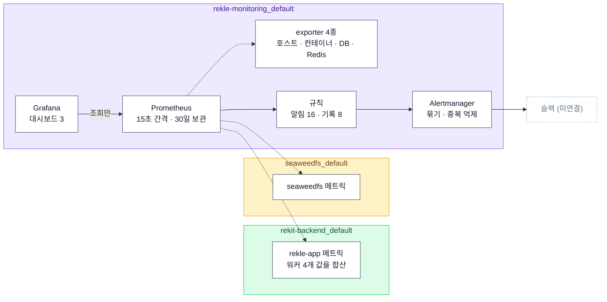
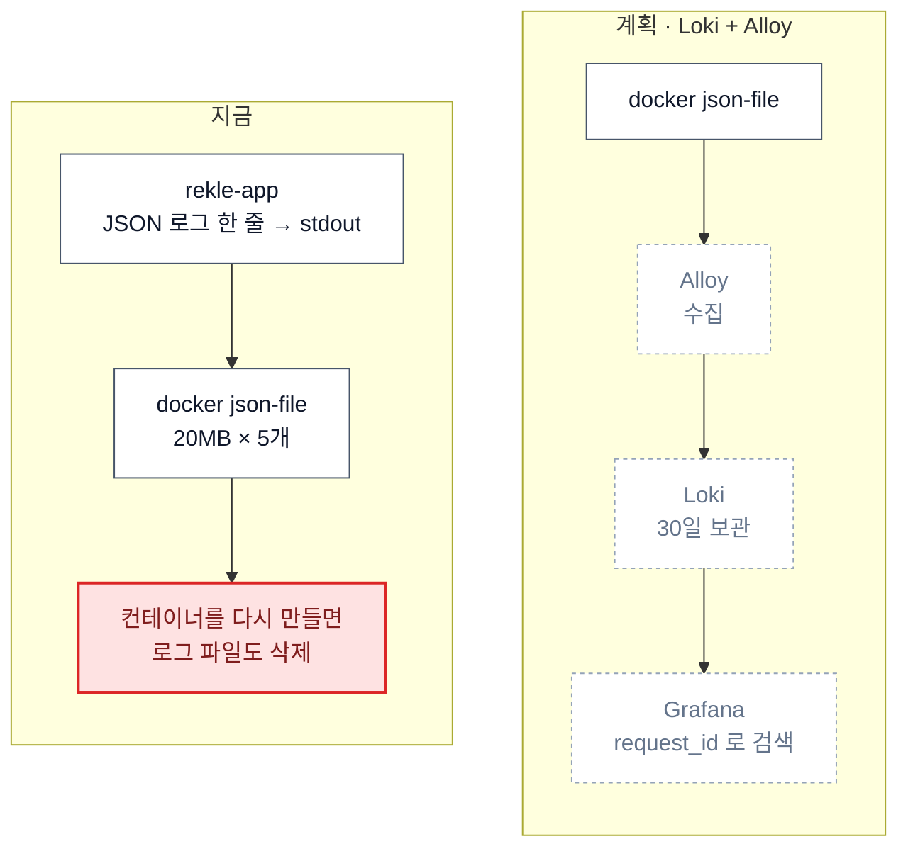
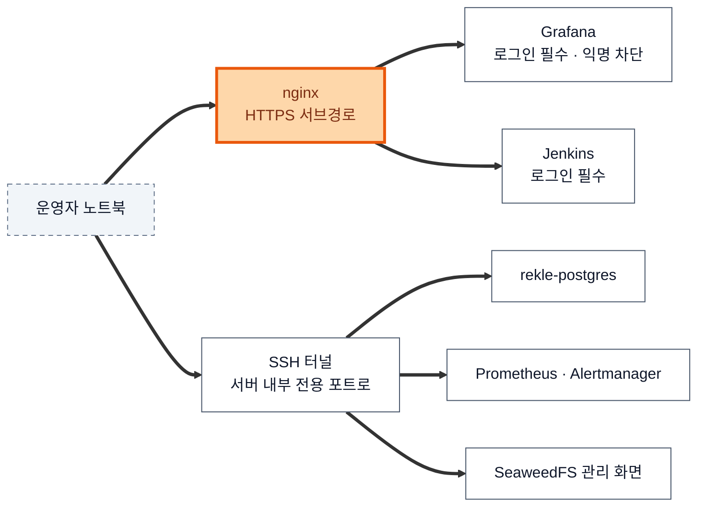

# 모니터링


**핵심 — 숫자는 같은 서버의 Prometheus 로 모여 알림과 대시보드가 되고, 로그는 아직 컨테이너 안에 머문다. 운영자가 들어오는 길은 HTTPS 와 SSH 두 가지뿐이다.**


## 메트릭 — 수집 → 규칙 → 알림 → 대시보드

_관측 스택을 앱과 다른 compose 프로젝트로 두고 앱 망에 "합류"하게 한 이유는, 앱을 배포할 때마다 관측 컨테이너가 다시 만들어지지 않게 하기 위해서다. Grafana 는 Prometheus 만 조회하므로 DB 비밀번호를 갖지 않는다._

| 구성 | 사실 |
| --- | --- |
| 수집 대상 | 8개 — rekle-app · node · cAdvisor · postgres · redis · seaweedfs · prometheus · alertmanager |
| 수집 간격 · 보관 | 15초 (cAdvisor 30초) · 30일 또는 10GB 중 먼저 닿는 쪽 |
| 규칙 | 알림 16개 · SLI 기록 규칙 8개 (SLI 5개 중 4개, 가동률은 `up` 으로 직접 계산) |
| 알림 묶기 | 같은 알림 이름·심각도끼리 묶음, critical 은 1시간마다 다시 알림 |
| 알림 억제 | 앱이 통째로 죽으면 앱 지표 경고는 숨김 · 같은 대상의 critical 이 있으면 warning 숨김 |
| 대시보드 | 3개 — 서비스 · 인프라 · 부하테스트 |
| 알림 전송 | `[미연결]` 슬랙 수신 주소가 아직 없어 판정만 한다 |

### 워커 4개의 숫자를 하나로

gunicorn 워커 4개는 메모리를 나눠 쓰지 않는다. 그대로 두면 수집할 때마다 다른 워커의 값이 잡혀 그래프가 톱니 모양이 된다. 그래서 워커마다 값을 파일에 기록하고, 메트릭을 내보낼 때 합산한다. 운영에서 이벤트 루프 지연 측정 횟수가 23,284 ≈ 4워커 × 약 5,800 으로 찍혀 합산이 동작함을 확인했다(11.10).

### 알림 16개

| 묶음 | 알림 |
| --- | --- |
| 앱 | RekleAppDown · RekleHigh5xxRatio · RekleEventLoopLagHigh · RekleDbPoolTimeouts |
| 결제 | ReklePaymentUnknown (1건이라도 즉시) · RekleTossLatencyHigh |
| DB · Redis | ReklePostgresDown · ReklePostgresDeadlocks · ReklePostgresConnectionsHigh · RekleRedisDown |
| 호스트 · 컨테이너 | HostDiskUsageHigh · HostDiskUsageCritical · ContainerRestarted |
| 사진 저장소 | SeaweedFSDown · SeaweedFSS3ErrorsHigh |
| 감시 자체 | MonitoringTargetDown |

_규칙은 `promtool test rules` 단위 테스트로 검증한다 (커밋 `422bbd3`)._

## 로그 — 지금과 계획

_지금 로그는 컨테이너 디렉터리 안 파일에만 있어서, 배포로 컨테이너를 다시 만들면 함께 지워진다. 0.0.6 배포 직후 rekle-app 로그는 101줄만 남아 있었다. 계획은 로그를 컨테이너 밖 Loki 에 30일 보관하고, Grafana 에서 `request_id` 로 찾는 것이다._

| 항목 | 지금 | 계획 |
| --- | --- | --- |
| 형식 | structlog JSON 한 줄, `request_id` · `user_id` 자동 포함 | 같음 |
| 보관 | 컨테이너당 20MB × 5개, 재생성 때 삭제 | Loki 30일 |
| 로테이션 없는 컨테이너 | nginx · jenkins · seaweedfs · registry · certbot · rekle-web | 로테이션 추가 |
| 검색 | `docker logs <컨테이너> \| grep <id>` | Grafana 에서 ID 클릭 → 같은 ID 로그 |
| 라벨 | — | 컨테이너 · 서비스 · env 만. `request_id` 는 라벨로 쓰지 않는다 (값 종류가 무한해 색인이 커진다) |
| 오류 추적 | Sentry 코드만 있음, 키 없음 | Sentry 무료 플랜 연결 |

## 운영자 접근 경로

_로그인 화면이 있는 도구(Grafana · Jenkins)만 HTTPS 경로로 열고, 로그인 기능이 없는 화면(Prometheus · SeaweedFS 관리 화면)과 DB 는 SSH 터널로만 연다. 인증이 없는 화면을 인터넷에 두지 않는다는 기준이다._

| 도구 | 경로 | 인증 |
| --- | --- | --- |
| Grafana | nginx HTTPS 서브경로 | 관리자 로그인, 익명 접근 차단, 비밀번호 미설정 시 기동 거부 |
| Jenkins | nginx HTTPS 서브경로 | 로그인. 서버 Docker 를 다룰 수 있는 도구라 직접 포트는 닫았다 |
| PostgreSQL | SSH 터널 | DB 계정 |
| Prometheus · Alertmanager | SSH 터널 | 없음 → 그래서 터널로만 |
| SeaweedFS 관리 화면 | SSH 터널 | 없음 → 그래서 터널로만 |


**알려진 대가** — Grafana · Jenkins 가 쇼핑몰과 같은 주소(서브경로) 아래에 있어서, 두 도구에 XSS 가 있으면 쇼핑몰 쿠키와 저장소에 닿을 수 있다. 서브도메인 분리 또는 IP 제한을 장기 과제로 두었다.

