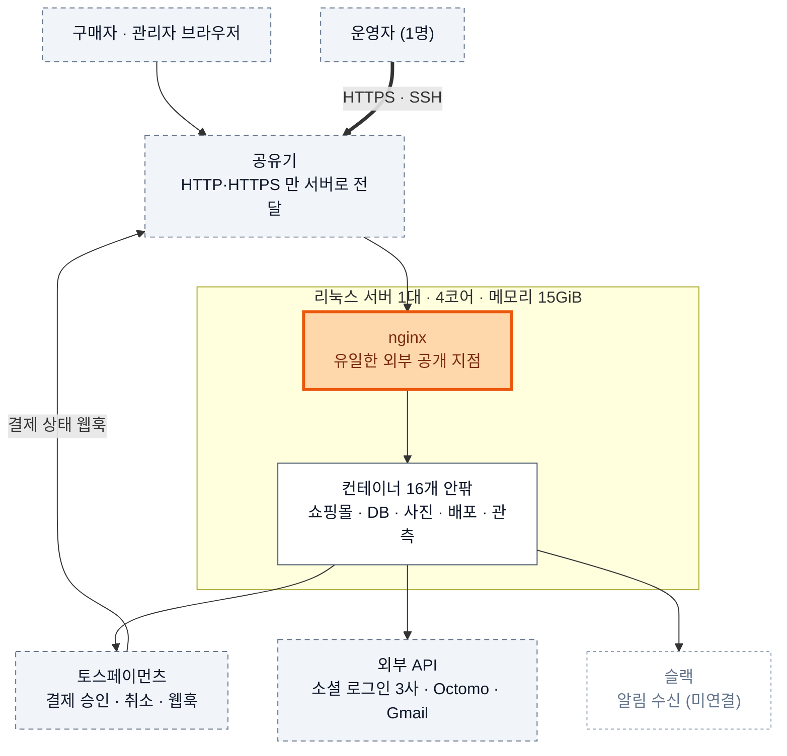

# 전체 구성


**핵심 — 구매자, 토스 웹훅, 운영자 모두 같은 공유기와 같은 nginx 를 지나 서버 1대로 들어온다.**


_들어오는 길을 하나로 모은 이유는 지킬 곳을 하나로 줄이기 위해서다. 나가는 연결(토스 · 소셜 로그인 · 문자 · 메일)은 앱이 시작하고, 들어오는 연결은 모두 nginx 가 받는다. 슬랙은 알림 설정만 끝났고 수신 주소가 아직 연결되지 않았다._

## 구성 요소

| 구분 | 무엇 | 역할 |
| --- | --- | --- |
| 사용자 | 구매자 · 관리자 브라우저 | Vue 화면을 받아 같은 주소의 API 를 부른다 |
| 운영자 | 1명 | HTTPS 로 운영 도구를, SSH 로 서버 내부 전용 도구를 연다 |
| 공유기 | 집 네트워크 | 바깥 요청 중 HTTP·HTTPS 만 서버로 넘긴다 |
| 서버 | 리눅스 1대 (4코어 · 메모리 15GiB · 디스크 98GB) | 쇼핑몰 · DB · 사진 저장소 · 배포 도구 · 관측 도구가 모두 여기 있다 |
| 결제 | 토스페이먼츠 | 결제 승인 · 취소 · 조회 API, 결제 상태 웹훅 |
| 인증 | 카카오 · 네이버 · 구글 · Octomo | 소셜 로그인, 휴대폰 확인 (QR 을 찍어 문자 한 통) |
| 메일 | Gmail | 가입 인증 코드 · 결제 안내 · 문의 답변 |
| 알림 | 슬랙 | 미연결 — 지금은 Alertmanager 가 판정만 하고 보내지 않는다 |

## 서버 1대를 고른 배경

5월부터 "어디에 올릴지 미정(네이버 클라우드, Lightsail, EC2)"으로 남아 있다가, 08.23 에 nginx 와 SeaweedFS 가 이미 떠 있던 서버에 얹었다. 새로 고른 것이 아니라 이미 있던 것을 쓴 결정이다. 그 결과와 대가는 [주요 설계 결정](../05-decisions.md)과 [회고](../09-retrospective.md)에서 다룬다.
