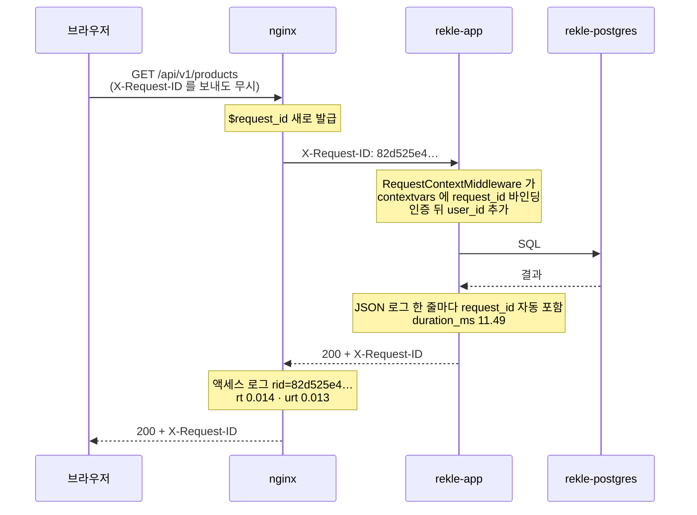

# 요청 흐름


**핵심 — ID 는 nginx 가 발급하고 바깥에서 온 값은 버린다. 그 ID 하나로 nginx 로그와 앱 로그의 같은 요청을 찾는다.**




_ID 를 nginx 에서 만드는 이유는 nginx 가 요청을 가장 먼저 받는 곳이라서다. 앱에서 만들면 nginx 로그에는 ID 가 없고, 클라이언트가 보낸 값을 그대로 쓰면 다른 요청의 ID 를 흉내 내 로그를 섞을 수 있다. 그림의 숫자는 11.10 운영 검증 때 실제로 찍힌 값이다._

## 단계별로 남는 것

| 단계 | 하는 일 | 남는 기록 |
| --- | --- | --- |
| nginx | `$request_id` 발급, 클라이언트의 `X-Request-ID` 무시, 앱에 헤더로 전달 | 액세스 로그 `rid` · `rt`(전체 시간) · `urt`(앱 응답 시간) |
| 앱 미들웨어 | `RequestContextMiddleware` 가 요청 시작 때 contextvars 를 비우고 `request_id` 바인딩 | 이후 모든 로그 줄에 자동 포함 |
| 인증 | 로그인 사용자를 확인하면 `user_id` 추가 | 같은 요청의 로그에 사용자 번호 |
| 응답 | 같은 `X-Request-ID` 를 응답 헤더로 돌려줌 | 사용자가 문의할 때 브라우저에서 이 값을 알려 줄 수 있다 |

## 실제로 확인한 것 (11.10)

```text
응답 헤더  X-Request-ID: 82d525e4ce2d216eb193e38d1c11beca
nginx     "GET /api/v1/products?size=1 HTTP/1.1" 200 ... rid=82d525e4… rt=0.014 urt=0.013
app       {"event": "http_request", "path": "/api/v1/products", "status": 200,
           "duration_ms": 11.49, "request_id": "82d525e4…"}
```

* 위조 헤더(`X-Request-ID: attacker-forged-id`)를 보내도 앱 로그에 위조값 0건
* `rt` − `urt` 가 크면 nginx 와 브라우저 사이(네트워크 · 업로드)가 느린 것이다

## 왜 contextvars 인가

워커 하나가 비동기로 요청 여러 개를 동시에 처리한다. 스레드별 저장소는 비동기 작업 사이에서 값이 섞이므로, 작업(task)마다 따로 값을 갖는 contextvars 에 담는다. structlog 의 `merge_contextvars` 가 로그를 쓸 때마다 이 값을 꺼내 붙인다.

## 지금의 한계

| 한계 | 영향 | 계획 |
| --- | --- | --- |
| 로그가 컨테이너 안 파일에만 있다 | 배포로 컨테이너를 다시 만들면 이전 요청의 로그가 사라진다 | Loki + Alloy ([모니터링](monitoring.md)) |
| nginx → 앱 사이에 연결 재사용이 없다 | 요청마다 새 TCP 연결 (같은 서버 안이라 영향은 측정 전) | 부하테스트 때 측정 후 판단 |
| 외부 사용자의 실제 IP 기록 여부 | 11.10 검증은 같은 네트워크 안에서 해서 공유기 주소로 찍혔다 | `[확인 필요: 외부 요청의 client_ip]` |
