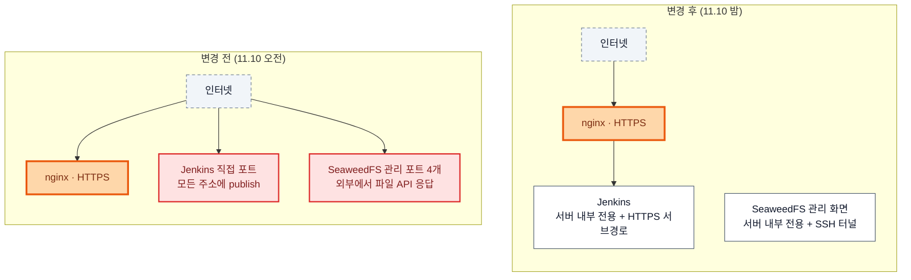
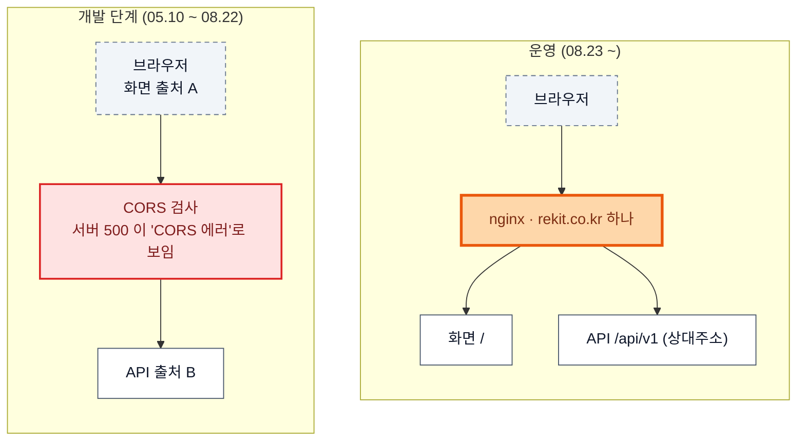
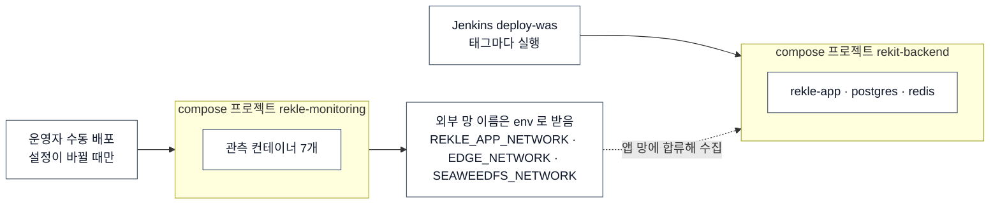
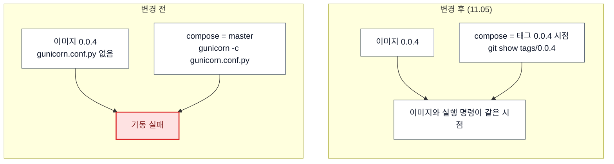

# 주요 설계 결정


**핵심 — 네 결정 모두 "무엇이 깨졌거나 깨질 뻔했는가"에서 출발했고, 각각 감수한 대가가 있다.**


| # | 결정 | 계기 | 근거 커밋 |
| --- | --- | --- | --- |
| 1 | 외부 공개 지점은 nginx 하나 | 관리 포트가 바깥에서 응답 | `b9c2e05` · 11.10 서버 변경 |
| 2 | 화면과 API 를 같은 주소 아래 | CORS 오류가 서버 오류를 가림 | 프론트 `e9215d5` |
| 3 | 관측 스택을 별도 compose 프로젝트로 | 앱 배포와 감시의 생명주기 분리 | `422bbd3` |
| 4 | 롤백 때 compose 도 태그 시점 것으로 | 이전 태그로 되돌리면 기동 실패 | `ec02f66` |

***

## 1. 외부 공개 지점은 nginx 하나



_방화벽 대신 compose 바인딩으로 막은 이유: Docker 의 포트 publish 는 iptables 에 직접 규칙을 넣어 ufw 를 우회한다. 막는 위치를 "포트를 여는 그 파일"로 옮겨야 다시 열리지 않는다._

| | |
| --- | --- |
| **상황** | 11.10 서버 점검에서 SeaweedFS 의 관리 포트 4개와 Jenkins 직접 포트가 모든 주소에 publish 돼 있었다. 바깥에서 SeaweedFS 파일 API 가 응답했고, 이 화면에는 로그인 기능이 없다. |
| **고려한 선택지** | ① 호스트 방화벽(ufw)으로 막기 ② compose 의 바인딩 주소를 서버 내부로 고정 ③ 관리 도구를 별도 서브도메인으로 분리 |
| **결정** | ② — 모든 compose 의 포트를 서버 내부 전용으로 바꾸고, 로그인 있는 도구는 nginx HTTPS 경로, 로그인 없는 도구는 SSH 터널로만 연다 |
| **감수한 비용** | 관리 화면을 열 때마다 SSH 터널이 필요하다. Grafana · Jenkins 가 쇼핑몰과 같은 주소 아래에 놓인다(③을 미룸) |
| **결과** | 바깥에서 관리 포트 4개 · Jenkins 직접 포트 모두 응답 없음. 같은 시점 상품 이미지 · 쇼핑몰 · API 200 유지 |

```yaml
# SeaweedFS compose (레포 밖, 11.10) — 포트 값은 생략
ports:
-  - "<포트>:<포트>"            # 모든 주소
+  - "127.0.0.1:<포트>:<포트>"  # 서버 안에서만
```

변경 전에 데이터 디렉터리 전체를 압축 백업하고 compose 파일도 날짜 붙은 사본을 남겼다. DB 는 이보다 앞선 08.30 에 같은 방식(서버 내부 바인딩 + SSH 터널)으로 처음 열었다(`b9c2e05`).

***

## 2. 화면과 API 를 같은 주소 아래에



_주소를 하나로 모은 이유: 출처가 다르면 브라우저가 CORS 검사를 하고, 서버가 500 을 내면서 CORS 헤더를 빠뜨리면 브라우저에는 "CORS 에러"만 보인다. 05.10 에 실제로 이 때문에 서버 내부 오류를 CORS 문제로 오인했다._

| | |
| --- | --- |
| **상황** | 개발 단계에서 화면과 API 가 다른 출처였고, 서버 오류가 CORS 오류로 가려져 원인 찾기가 늦어졌다(05.10). |
| **고려한 선택지** | ① 출처를 나눈 채 CORS 허용 설정 유지 ② nginx 가 한 도메인 아래에서 경로로 화면과 API 를 나눔 |
| **결정** | ② — 화면은 빌드할 때 API 주소를 상대 경로 `/api/v1` 로 넣는다. 어느 도메인으로 접속해도 같은 주소의 API 를 부른다 |
| **감수한 비용** | 나중에 운영 도구도 같은 출처에 두게 되어 XSS 범위가 넓어졌다(결정 1 의 대가와 같은 뿌리). |
| **결과** | 운영에서 CORS 문제가 구조적으로 사라졌다. 화면 배포에는 비밀 설정 복사 단계가 없다 |

```dockerfile
# rekit_client Dockerfile (발췌)
# 어느 도메인/IP로 접속하든 같은 origin의 /api/v1로 호출 (nginx가 백엔드로 프록시) — CORS 회피
ENV VITE_API_BASE_URL=/api/v1
```

***

## 3. 관측 스택을 별도 compose 프로젝트로



_앱과 같은 compose 에 넣지 않은 이유: Jenkins 배포 잡은 태그마다 앱 프로젝트를 `up -d` 한다. 감시 도구가 같은 프로젝트에 있으면 배포 설정이 바뀔 때 감시도 같이 재생성되고, 앱 롤백이 감시 설정까지 되돌린다._

| | |
| --- | --- |
| **상황** | 11.10 운영 관측 스택(Prometheus · Alertmanager · Grafana · exporter 4종)을 올려야 했다. 서버는 1대다. |
| **고려한 선택지** | ① 앱 compose 에 포함 ② 같은 서버, 별도 compose 프로젝트 ③ 별도 모니터링 서버 |
| **결정** | ② — 프로젝트 `rekle-monitoring`. 합류할 앱 망 · 엣지 망 · 사진 저장소 망의 이름은 env 로 받는다 |
| **감수한 비용** | 서버 사본은 레포에서 수동으로 복사해 자동 동기화가 없다. 같은 서버라 서버가 멈추면 감시도 멈춘다 |
| **결과** | 컨테이너 7개 기동, 수집 대상 8개 모두 up, 기동 직후 울리는 알림 0건 (11.10). ③으로 옮길 때는 망 이름 대신 서버 주소를 넣으면 된다 |

```yaml
# infra/monitoring/prod/docker-compose.yml (발췌)
networks:
  app:
    external: true
    name: ${REKLE_APP_NETWORK:-rekit-backend_default}
  edge:
    external: true
    name: ${EDGE_NETWORK:-rekit_edge}
  seaweedfs:
    external: true
    name: ${SEAWEEDFS_NETWORK:-seaweedfs_default}
```

***

## 4. 롤백 때 compose 도 태그 시점 것으로



_이미지와 compose 를 같은 시점으로 묶은 이유: compose 의 실행 명령이 바뀌면, 새 compose 로 옛 이미지를 띄울 때 이미지 안에 없는 파일을 찾는다. 되돌리기 수단이 오히려 기동 실패를 만든다._

| | |
| --- | --- |
| **상황** | 배포 잡이 이미지는 선택한 태그로, compose 는 늘 master 것으로 썼다. 11.05 하루에 실행 명령이 두 번 바뀌어, 0.0.4 로 되돌리면 기동이 실패하는 상태가 됐다. |
| **고려한 선택지** | ① master compose 유지 (롤백은 손으로 수정) ② 태그로 `git checkout` ③ 태그의 compose 파일만 `git show` 로 별도 파일에 꺼내 쓰기 |
| **결정** | ③ — checkout 은 워크스페이스의 추적 파일을 바꾼 채 남겨 다음 SCM checkout 과 충돌할 수 있다. 별도 파일로 꺼내 쓰고 끝나면 지운다 |
| **감수한 비용** | compose 에서 Postgres 실행 옵션을 바꾸면 그 태그 배포 때 Postgres 컨테이너가 다시 만들어진다(수 초~수십 초 중단). 11.10 `pg_stat_statements` 적용 때 실제로 겪었다 |
| **결과** | 0.0.1 ~ 0.0.4 각 태그의 compose 를 꺼내 해석해 이미지와 실행 명령이 일치함을 확인. 같은 방식을 프론트 배포 잡에도 적용 |

```groovy
// Jenkinsfile.deploy (발췌)
sh "git show tags/${env.DEPLOY_TAG}:docker-compose.prod.yml > ${DEPLOY_COMPOSE}"
sh "IMAGE_TAG=${env.DEPLOY_TAG} docker compose -p rekit-backend -f ${DEPLOY_COMPOSE} up -d postgres redis app"
```

***

## 검토했지만 표에 넣지 않은 결정

| 결정 | 왜 여기서 뺐나 |
| --- | --- |
| `request_id` 는 nginx 가 발급 | [요청 흐름](04-architecture/request-flow.md)에서 그림과 함께 다룬다 |
| 메트릭을 로그와 같은 미들웨어에서 기록 (`dd0adea`) | 앱 내부 구현이라 인프라 구조에 영향이 작다 |
| 자원 대신 SLO 기반 알림 | [요구사항과 제약](02-constraints.md)에서 다룬다 |
| 로그는 ELK 대신 Loki + Alloy | 아직 운영에 적용 전이다 — [기술 선택 이유](06-tech-choices.md)에서 다룬다 |
