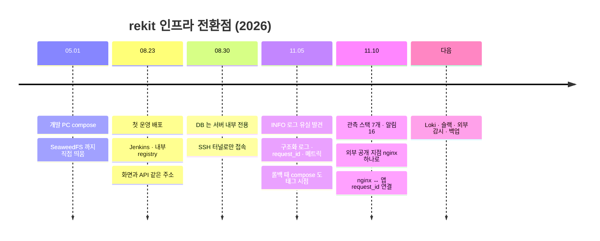
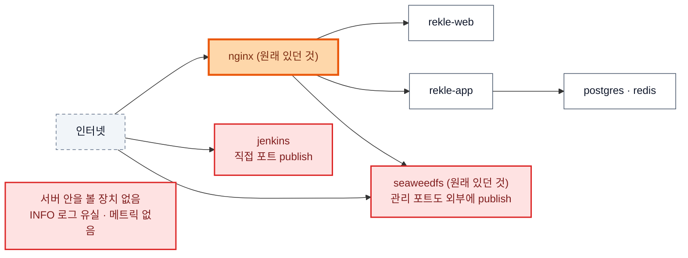
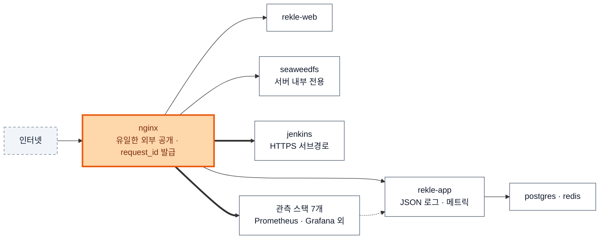

# 변경 이력


**핵심 — 구조는 한 번에 설계되지 않았다. 네 번의 전환점마다 드러난 문제 하나가 다음 구조를 정했다.**


_전환점을 날짜로 나눈 이유는 각 변화가 특정 사건에 대한 응답이었기 때문이다. 11.05 와 11.10 사이 닷새 동안 가장 많은 것이 바뀌었다._

## 전후 비교



**08.23 첫 배포**




**11.10 이후**




_두 그림의 차이는 상자 수가 아니라 색이다. 빨간 상자(바깥에 열린 관리 포트, 안을 볼 수 없는 상태)가 모두 사라지고, 주황(외부 공개)은 nginx 하나만 남았다._

## 전환점별 정리

### 08.23 · 첫 운영 배포

| | |
| --- | --- |
| **문제** | 5월부터 배포 위치가 정해지지 않았다. 화면과 API 의 출처가 달라 CORS 오류가 반복됐다 |
| **바꾼 것** | nginx · SeaweedFS 가 이미 있던 서버에 Jenkins · 내부 registry · 앱 · 화면 · DB · Redis 를 올렸다. 빌드와 배포를 두 잡으로 나눴다. 앱을 `rekit_edge` 에 붙여 nginx 가 이름으로 찾게 했다 |
| **같은 날 드러난 것** | 빈 DB 에 DB 변경 스크립트를 처음부터 적용하자 하나가 실패했다(개발 DB 는 이미 적용된 상태라 석 달간 숨어 있었다). 사진 업로드 주소가 Docker 내부 이름으로 서명돼 브라우저가 열지 못했다 |
| **근거** | `0da8389` `13fe44a` `397f85a` `3ba2efb` `af76abb` · 프론트 `e9215d5` |

### 08.30 · DB 는 서버 안에서만

| | |
| --- | --- |
| **문제** | 노트북의 DB 도구로 운영 DB 에 접속하려 했지만, 접속 정보의 호스트 이름이 Docker 망 안에서만 통하는 이름이었다 |
| **바꾼 것** | DB 포트를 서버 내부 전용으로 publish 하고, SSH 터널로만 접속한다. 같은 날 `www` DNS 를 지워 소셜 로그인 state 검증 실패(시작 호스트와 돌아오는 호스트가 다름)를 없앴다 |
| **근거** | `b9c2e05` |

### 11.05 · 안을 보기 시작

| | |
| --- | --- |
| **문제** | 앱 INFO 로그가 운영에서 전부 버려지고 있었다. 로그 로테이션이 없었고, 헬스체크는 DB 를 보지 않았고, 롤백하면 기동이 실패했다 ([문제와 배경](01-background.md)) |
| **바꾼 것** | 로깅 초기화 · structlog JSON · `request_id`/`user_id` 컨텍스트 · 민감정보 마스킹 · 로그 로테이션(20MB × 5) · 메트릭 · `/health/ready` · 배포 잡이 태그 시점 compose 사용. 태그 `0.0.5` |
| **결과** | 테스트 592 → 666 passed, ruff 0 · mypy 0 (11.05 마감 시점) |
| **근거** | `27ddb68` `1abedcb` `95547d8` `ec02f66` `dd0adea` |

### 11.10 · 운영 관측과 문 닫기

| | |
| --- | --- |
| **문제** | 메트릭은 있었지만 운영 서버에서 모으고 알리는 장치가 없었다. 점검 중 SeaweedFS 관리 포트가 바깥에서 응답하는 것을 발견했다 |
| **바꾼 것** | 운영 관측 스택 7개 · 알림 16개 · SLO 5개. 이벤트 루프 지연 · DB 풀 대기 · 외부 호출 시간 메트릭, DB · Redis · gunicorn 타임아웃. Jenkins · SeaweedFS 포트를 서버 내부 전용으로. nginx ↔ 앱 `request_id` 연결. 태그 `0.0.6` |
| **결과** | 테스트 746 passed, ruff 0 · mypy 0. 수집 대상 8개 up. 바깥에서 관리 포트 응답 없음 |
| **근거** | `6081921` `176cb69` `422bbd3` + 서버 변경(레포 밖, 날짜 붙은 백업 파일로 기록) |

## 그 사이의 작은 변화

| 날짜 | 변화 | 구조에 준 영향 |
| --- | --- | --- |
| 09.04 | 배포를 사람이 붙인 버전 번호(0.0.1) 기준으로 바꾸고 되돌리기 시험 | 태그 = 배포 단위가 이때 시작 |
| 10.02 | 사진 업로드 주소 발급을 관리자 전용으로, SVG 는 서버 검사 후 저장 | 업로드 경로의 권한 경계 |
| 11.13 | 상품 사진을 업로드 전 브라우저에서 1600px WebP 로 압축, 기존 사진 일괄 재압축 | 저장소 구조는 그대로, 목록 로딩 18.2초 → 1.8초 |

## 다음 전환점 후보

| 후보 | 해결하려는 것 |
| --- | --- |
| Loki + Alloy | 배포마다 로그가 사라지는 문제 |
| 슬랙 연결 · 서버 밖 업타임 감시 | 알림이 판정만 되고 전달되지 않는 문제, 서버가 통째로 멈출 때 알 방법이 없는 문제 |
| DB · 사진 서버 밖 백업 | 서버 1대가 망가지면 데이터도 같이 잃는 문제 |
