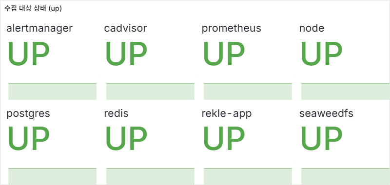
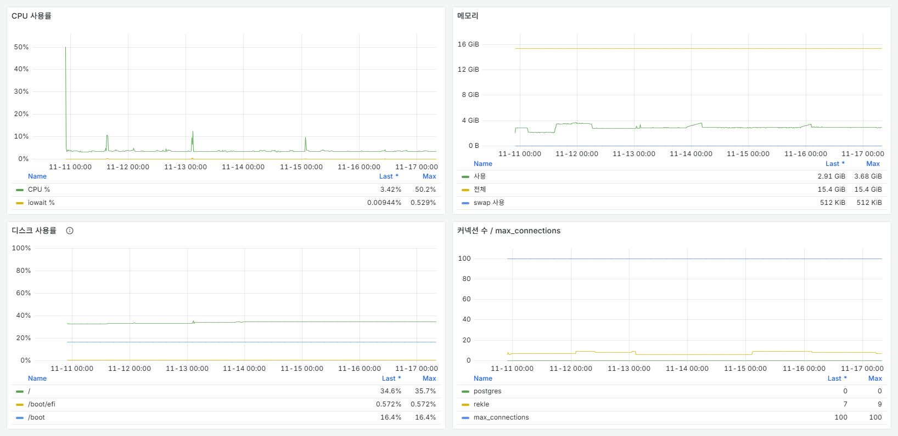
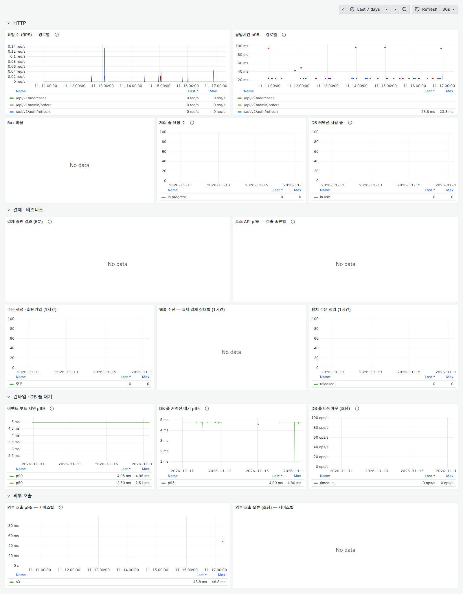

# 운영 현황


**핵심 — 측정할 장치는 갖췄고, 30일 단위 SLO 실측은 아직 쌓이는 중이다. 아래 숫자는 모두 날짜가 붙은 실측값이고, 빈 칸은 자료를 받아 채운다.**


## 확인된 수치

| 항목 | 값 | 측정 시점 · 출처 |
| --- | --- | --- |
| 서버 자원 | 4코어 · 메모리 15GiB (가용 12GiB) · 디스크 98GB 중 28% 사용 | 11.10 서버 점검 |
| 수집 대상 | 8개 모두 up | 11.10 관측 스택 기동 직후 |
| 울리는 알림 | 0건 | 11.10 관측 스택 기동 직후 |
| 요청 한 건 (상품 1개 조회) | nginx 전체 14ms · 앱 응답 13ms · 앱 처리 11.49ms | 11.10 `request_id` 검증 요청 1건 |
| 백엔드 테스트 | 746 passed · ruff 0 · mypy 0 | 11.10 태그 `0.0.6` |
| 상품 목록 로딩 (Fast 4G, 캐시 없음) | 18.2초 → 1.8초 · 이미지 전송량 19.4MB → 1.5MB | 11.13 [사례](../cases/case-01-image.md) |
| 운영 상품 수 | 7개 | 11.10 일지 |

## 대시보드 (2026-11-17 촬영, 최근 7일)

### 수집 대상



_수집 대상 상태를 대시보드 맨 위 패널로 둔 이유는, 대상 하나가 내려가면 그 대상의 다른 그래프가 "0" 이 아니라 "비어 있음"으로 보여 문제를 놓치기 쉽기 때문이다. 이 장이 다른 그래프를 믿을 수 있는지의 전제다._

### 인프라



_서버 1대에 모든 것이 올라가 있어서, 같은 축에서 남은 여유를 보는 것이 이 대시보드의 목적이다. 지금 쓰는 양은 CPU 약 3% · 메모리 약 19% · 디스크 약 35% · DB 커넥션 7% 이고, 부하테스트 전 기준선으로 남긴다._

| 지표 | 최근 값 | 7일 최대 | 한도 |
| --- | --- | --- | --- |
| 호스트 CPU | 3.42% | 50.2% (그래프 시작 직후 한 번, 원인 `[확인 필요]`) | 4코어 |
| 메모리 사용 | 2.91GiB | 3.68GiB | 15.4GiB |
| 디스크 `/` | 34.6% | 35.7% | 98GB |
| PostgreSQL 커넥션 (앱 계정) | 7 | 9 | 100 |

### 서비스



_요청 수 · 지연 · 오류 · 결제 · 런타임 · 외부 호출을 한 화면에 둔 이유는, 느려졌을 때 "어느 층이 원인인지"를 위에서 아래로 한 번에 좁히기 위해서다. 지금은 트래픽이 적어 대부분 그래프가 바닥에 붙어 있다._

| 지표 | 7일 관측 | 읽는 법 |
| --- | --- | --- |
| 요청 수 | 경로별 최대 약 0.14 req/s | 운영 상품 7개 규모의 실제 트래픽 |
| 응답시간 p95 | 대부분 20ms 안팎, 간헐적으로 100ms 가까이 | SLO(300ms) 안 |
| 5xx 비율 | 패널 값 없음 | 7일 동안 5xx 시계열이 생기지 않았다 |
| 결제 승인 · 토스 p95 · 웹훅 | 패널 값 없음 | 7일 동안 결제가 없었다 |
| 이벤트 루프 지연 | p99 4.95ms · p50 2.50ms | 워커를 막는 동기 작업이 없다 |
| DB 풀 대기 p95 · 풀 타임아웃 | 4.80ms · 0 | 커넥션을 기다린 요청이 없다 |


**스크린샷으로 새로 확인한 것** — 인프라 대시보드의 "컨테이너 메모리 (working set)" 패널이 7일 내내 값이 없다. cAdvisor 수집 대상은 UP 인데 컨테이너별 지표가 나오지 않는 상태로, 11.10 에 "운영 Linux 에서 확인 필요"로 남겨 둔 항목이 실제로 비어 있었다. [회고](09-retrospective.md)의 남은 과제에 올렸다.


## SLO 실측

| SLI | 목표 (30일) | 실측 | 기간 |
| --- | --- | --- | --- |
| 가용성 (5xx 아닌 비율) | ≥ 99.5% | `[자료 필요]` | `[자료 필요]` |
| 조회 API 300ms 이내 비율 | ≥ 95% | `[자료 필요]` | |
| 결제 승인 1초 이내 비율 | ≥ 95% | `[자료 필요]` | |
| 결제 성공률 | ≥ 99% | `[자료 필요]` | |
| 가동률 | ≥ 99.5% | `[자료 필요]` | |

_필요한 자료: Grafana 또는 Prometheus 에서 아래 식을 30일 범위로 실행한 결과. 관측 스택이 11.10 에 시작해서, 30일 창이 다 차는 시점은 12.10 이다._

```promql
# 가용성 (docs/slo.md §2.1)
sum_over_time(rekle:sli_availability_good:rate5m[30d])
  / sum_over_time(rekle:sli_availability_total:rate5m[30d])

# 가동률 (§2.5)
avg_over_time(up{job="rekle-app"}[30d])
```

## 운영 사건 기록

| 항목 | 값 |
| --- | --- |
| 11.10 이후 울린 알림 수 | `[자료 필요 — Alertmanager 이력 또는 Prometheus ALERTS]` |
| 11.10 이후 배포 횟수 | `[자료 필요 — Jenkins deploy-was 실행 이력]` (11.10 이후 생긴 태그는 `0.0.7` 하나, 11.13) |
| 컨테이너 재시작 | `[자료 필요 — ContainerRestarted 발생 여부]` |
