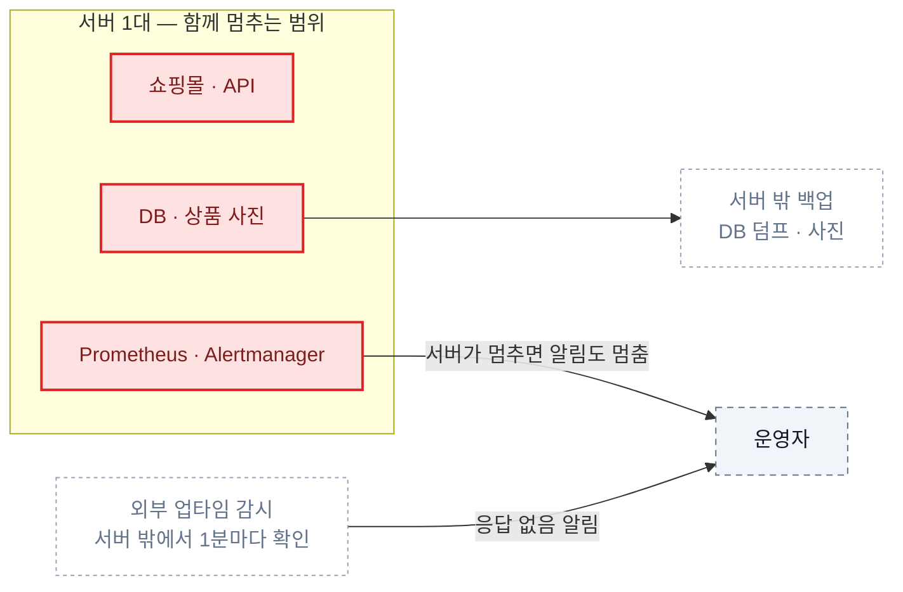

# 회고와 남은 과제


**핵심 — 서버 안은 보이게 됐지만, 서버가 통째로 멈추는 경우는 아직 아무것도 알려 주지 않는다.**


## 잘된 점

| 무엇 | 근거 |
| --- | --- |
| 바꾸기 전에 측정하고, 바꾼 뒤 같은 방법으로 다시 쟀다 | `request_id` 위조 시험, 워커 합산 값 검증(23,284 ≈ 4 × 5,800), 이미지 로딩 예측 1.81초 = 실측 1.81초 |
| 운영 서버 변경마다 되돌릴 수단을 먼저 남겼다 | 11.10 기존 설정 파일을 바꾼 6건 모두 날짜 붙은 백업 파일을 먼저 남겼고, SeaweedFS 는 데이터 디렉터리 압축 백업 후 적용 |
| 결제의 "결과 모름"을 별도 상태로 다뤘다 | 시간 초과 때 재결제를 권하지 않아 이중 결제 경로를 막았다 (07.07) |
| 규칙과 설정도 테스트했다 | 알림 규칙 `promtool test rules`, compose 설정 테스트 `tests/test_compose_config.py` |

## 아쉬운 점

| 무엇 | 왜 아쉬운가 |
| --- | --- |
| 첫 배포부터 두 달 반 동안 로그가 남지 않았다 | 그 기간의 결제 · 방치 주문 처리 기록이 없다. 로깅 초기화는 첫 배포 체크리스트에 있었어야 했다 |
| 서버 설정 일부가 git 밖에 있다 | nginx · SeaweedFS · Jenkins 설정은 백업 파일로만 이력이 남는다. 서버를 새로 만들면 일지를 읽고 손으로 재현해야 한다 |
| 운영 도구를 쇼핑몰과 같은 주소 아래 두었다 | 편의를 위해 서브경로를 골랐고, 같은 출처 위험을 장기 과제로 미뤘다 |
| 관측 스택의 서버 사본이 수동 복사다 | 레포를 고쳐도 서버에 자동으로 반영되지 않는다 |

## 남은 과제

_우선순위를 이 그림으로 정했다. 서버가 멈추면 감시 도구도 같이 멈추므로, 서버 안에 무엇을 더 붙여도 이 경우는 잡지 못한다. 그래서 서버 밖에 두는 두 가지(업타임 감시 · 백업)가 맨 앞이다._

| 순위 | 과제 | 해결하려는 것 | 상태 |
| --- | --- | --- | --- |
| 1 | DB · 사진 서버 밖 백업 + 복구 시험 | 서버 1대가 망가지면 데이터도 같이 잃는다 | 미착수 |
| 2 | 서버 밖 업타임 감시 | 서버가 통째로 멈추면 알릴 장치가 없다 | 미착수 |
| 3 | 슬랙 수신 주소 연결 | 알림이 판정만 되고 사람에게 가지 않는다 | 설정 완료, 주소 미연결 |
| 4 | 사진 저장소 접근 권한 정리 | 저장소 쪽 인증 설정 점검 | 미착수 |
| 5 | Loki + Alloy | 배포마다 로그가 사라진다 | 계획 확정 (9단계) |
| 6 | Sentry 키 연결 | 예외가 쌓여도 묶어서 볼 곳이 없다 | 코드 완료, 키 미발급 |
| 7 | 요청 수 제한 | 로그인(bcrypt)에 요청이 몰리면 워커가 막힌다 | 정책 결정 필요 |
| 8 | cAdvisor 컨테이너별 지표 복구 | 컨테이너 메모리 패널이 7일 내내 비어 있다 (11.17 확인) — 컨테이너 하나의 누수를 볼 수 없다 | 원인 미확인 |
| 9 | 운영 도구 서브도메인 분리 또는 접근 제한 | 같은 출처 위험 | 장기 |
| 10 | 서버 설정을 비공개 infra 레포로 | git 밖 설정 | 장기 |

## 서버 1대에 대한 판단

지금 규모(운영 상품 7개)에서 서버 1대는 합리적인 선택이다. 대신 "망가지지 않게"보다 "망가지면 알고, 되살릴 수 있게"를 목표로 둔다. 남은 과제 1·2 가 그 목표의 최소 조건이다.

부하테스트는 운영 서버에서 하지 않는다는 원칙이 있어서, 테스트할 때만 쓰는 임시 클라우드 서버가 필요하다. 그 결과는 [운영 현황](08-operations.md)에 숫자로 더한다.
