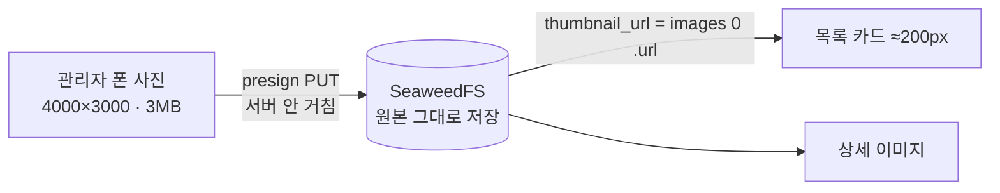

# 11.13 · 상품 이미지 최적화 (18.2초 → 1.8초)

> 💡 작업 과정(시간순, 커밋, 함정)은 [11.13 일지](https://jineuns-tech.gitbook.io/jineuns-tech-docs/rekit/2026-11/2026-11-13) 에 있다. 이 노트는 그 작업을 **문제 → 원인 → 해결 → 측정 데이터 → 성과** 로 다시 묶은 결과 보고서다. 모든 수치는 이 날 직접 잰 값이고, 추정치는 따로 표시했다.
>
> 저장소: `rekit_client` · `rekle_backend` · 도메인 `rekit.co.kr`

> 💡 **한눈에**
>
> * **문제**: 상품 카드 썸네일에 폰 원본 사진(4000×3000, 장당 2.5\~3.9MB)이 그대로 내려갔다. 상품 6개짜리 목록 한 화면에 이미지만 **19.4MB**였다.
> * **원인**: 업로드가 presign(브라우저 → 스토리지 직접 PUT) 구조라 서버가 사진을 줄일 지점이 없었다. 썸네일도 따로 없이 원본 1번 이미지를 그대로 썼다.
> * **해결**: ① 업로드 직전 브라우저에서 1600px WebP 로 줄인다 ② 기존 이미지 일괄 재압축 스크립트 ③ 로딩 스켈레톤
> * **성과 (같은 조건 A/B, 3회 측정 중앙값)**
>   * 목록 이미지 용량 **19.4MB → 1.5MB (-92.2%)**, 새 업로드 기준 **0.88MB (-95.5%)**
>   * Fast 4G 목록 이미지 전부 표시 **18.2초 → 1.8초 (10배)**, 새 업로드 기준 **1.2초 (15.7배)**
>   * Slow 4G **102.5초 → 10.1초 (10배)**, 새 업로드 기준 **6.1초 (16.9배)**
> * **운영 상태 (2026-11-13 재확인)**: 아직 **개선 전**이다. 프론트 `0.3.12` 는 태그만 있고 Jenkins 배포 전이며, 운영 이미지 재압축도 실행 전이다. 아래 성과는 **운영 원본 파일에 출시할 코드를 그대로 적용해 통제 환경에서 잰 값**이다. 배포 후 운영 실측으로 갱신해야 한다.

***

### 1. 문제 — 무엇이 느렸나

#### 증상

* 상품 목록과 상세에서 사진이 늦게 뜬다. 로딩 표시도 없어서 민트색 빈 카드만 보이다가 사진이 툭 나타난다.
* 처음 질문은 "원형 인디케이터라도 붙여서 불러오는 중인 느낌을 줘야 하나?" 였다. 그런데 **로딩 표시는 기다림을 견디게 할 뿐 기다리는 시간 자체를 줄이지 않는다.** 그래서 원인부터 쟀다.

#### 발견 과정

1. DevTools Network 탭에서는 이미지가 전부 `(disk cache)` 로 나와 문제가 보이지 않았다. 개발자는 같은 페이지를 반복해서 보기 때문이다.
2. **Disable cache** 를 켜고 다시 받으니 카드 이미지 한 장이 2.5\~3.9MB로 찍혔다.

!2026-11-13 네트워크탭 원본 용량.png

> ⚠️ **디스크 캐시가 문제를 가린다**
>
> 개발자 화면은 늘 캐시가 데워진 상태다. 처음 온 손님은 캐시가 없다. 성능은 **캐시 끔 + 회선 속도 제한** 으로 봐야 손님 화면과 같아진다.

#### 원인 구조

> 🐞 **원인**
>
> 1. **presign 업로드**: 브라우저가 스토리지로 파일을 직접 올리고, 서버는 `/uploads/confirm` 에서 존재와 타입만 확인한다. 파일 본문을 줄일 단계가 구조적으로 없다. (Spring 비유: `MultipartFile` 을 컨트롤러에서 받으면 저장 전에 리사이즈를 끼우면 되지만, S3 presigned URL 은 컨트롤러를 아예 거치지 않는다.)
> 2. **썸네일 부재**: 백엔드 `thumbnail_url` 은 `images[0].url` 그대로다 (`app/catalog/catalog_utils.py`). 화면에서 약 200px인 카드에 4000px 원본이 들어간다.
> 3. **캐시 헤더 없음**: 이미지 응답에 `Cache-Control` 이 없다. 재방문 캐시도 브라우저 휴리스틱(`Last-Modified` 기반)에만 기댄다.

***

### 2. 기준선 — 개선 전 실제 데이터 (운영 `rekit.co.kr`)

공개 API(`/api/v1/products`, `/products/{id}`)로 이미지 URL 12개를 모으고, 운영 스토리지에서 직접 받아 쟀다. **같은 날 두 번 쟀고, 파일은 두 번 다 바이트 단위로 같았다.**

#### 이미지 자체

| 항목           | 값                                                                               |
| ------------ | ------------------------------------------------------------------------------- |
| 상품 / 이미지     | 6개 / 12장 (상품당 2장)                                                               |
| 해상도          | **12장 전부 4000×3000** (12MP 폰 원본)                                                |
| 장당 용량        | 2,491,103 \~ 3,912,296 B                                                        |
| 목록 썸네일 6장 합계 | **19,371,134 B (19.4MB)**                                                       |
| 전체 12장 합계    | 38,742,268 B (38.7MB)                                                           |
| EXIF         | 12장 전부 포함 (장당 43\~58KB), 8장은 세로 사진(`orientation=6`)                             |
| GPS 위치       | 0/12 (위치 유출 없음)                                                                 |
| 중복           | **6쌍 전부 md5 동일**. 상품마다 같은 사진이 2번 올라가 있다                                         |
| 응답 헤더        | `Content-Type: image/jpeg`, `ETag`, `Last-Modified` 만 있고 **`Cache-Control` 없음** |

#### 운영 다운로드 시간 (`curl`, 12장)

| 측정       | 12장 합계 시간 | 장당 최소 / 중앙 / 최대         |
| -------- | --------: | ----------------------- |
| 1차       |    13.37초 | 0.56 / 1.15 / 2.01초     |
| 2차 (재확인) |    34.67초 | 0.49 / 2.00 / **8.92초** |

> 같은 파일인데 2차가 2.6배 느렸다. 회선 상태에 따라 한 장에 9초까지 걸린다. **파일이 클수록 회선 흔들림이 그대로 대기 시간으로 증폭된다**는 뜻이다.

#### 사용자 체감 — 목록 화면 (통제 환경, 3회)

| 회선                       |  첫 이미지 표시 |   6장 전부 표시 |
| ------------------------ | --------: | ---------: |
| Fast 4G (9Mbps, 60ms)    | **12.4초** |  **18.2초** |
| Slow 4G (1.6Mbps, 150ms) | **79.0초** | **102.5초** |

* Fast 4G 에서 손님이 첫 사진을 보기까지 12초가 걸린다. Slow 4G 에서는 1분 40초가 지나야 목록이 다 찬다.
* 이론값 대조: 19.37MB를 9Mbps로 받으면 17.2초, 1.6Mbps로 받으면 96.9초다. 측정값(18.2초, 102.5초)과 거의 같다. **느림의 거의 전부가 순수 전송량 때문**이라는 근거다.

***

### 3. 해결 — 무엇을 왜 이렇게 했나

| # | 레버       | 대상              | 방법                                                                                                                                                                                                          | 커밋            |
| - | -------- | --------------- | ----------------------------------------------------------------------------------------------------------------------------------------------------------------------------------------------------------- | ------------- |
| ① | 업로드 전 압축 | **앞으로 올라올** 이미지 | `src/utils/compressImage.ts`: `createImageBitmap(imageOrientation:'from-image')` → 긴 변 1600px canvas → **WebP q0.82** (미지원 시 JPEG). 300KB·1600px 이하면 건너뜀, 결과가 더 크면 원본 유지. `uploadImage()` 에서 presign 직전에 호출 | 프론트 `92c8e18` |
| ② | 일괄 재압축   | **이미 올라간** 이미지  | `scripts/recompress_product_images.py`: 1600px **JPEG q82 progressive**, 같은 키·같은 Content-Type 으로 덮어씀 → **DB 무수정**. dry-run 기본, `--apply` 시 `backup/originals/` 에 원본 백업, 재실행 시 건너뜀(멱등)                       | 백엔드 `62bf5fd` |
| ③ | 체감 개선    | 모든 상품 이미지       | `ProductTile.vue`: 로딩 중 shimmer 스켈레톤 → 로드 후 0.25초 fade-in, `decoding="async"`, `prefers-reduced-motion` 대응                                                                                                  | 프론트 `92c8e18` |

> 💡 **선택의 이유**
>
> * **왜 서버가 아니라 브라우저에서 줄였나**: presign 구조를 유지하면서 서버 부하와 업로드 트래픽을 같이 줄일 수 있다. 관리자 업로드도 MB 대신 KB 단위가 된다.
> * **왜 1600px인가**: 상세 화면에서 확대해도 깨지지 않는 선이다. 카드 하나만 보면 과하다 (→ 다음 단계: 480px 썸네일).
> * **왜 기존 이미지는 WebP 가 아니라 JPEG 인가**: 키가 `.jpg` 라서, 포맷을 바꾸면 키와 DB URL 까지 바꿔야 한다. 같은 포맷으로 덮어쓰면 마이그레이션이 없다.
> * **왜 스피너가 아니라 스켈레톤인가**: 그리드에서 스피너 여러 개는 산만하고 더 느려 보인다. 스켈레톤은 레이아웃을 미리 보여 줘서 기다림이 덜 지루하다.

> 💡 **부수 효과**
>
> canvas 에 다시 그리면 EXIF(촬영 기기 등 메타데이터)가 사라진다. 이번 데이터에는 GPS 가 없었지만, 앞으로 위치가 담긴 사진이 올라와도 공개되지 않는다. 대신 회전 정보도 사라지므로 `imageOrientation: 'from-image'` 로 회전을 먼저 픽셀에 반영했다.

***

### 4. 결과 — 개선 후 데이터

#### 4-1. 용량

|                     |    목록 썸네일 6장 |       전체 12장 | 장당 범위        |                    개선 |
| ------------------- | -----------: | -----------: | ------------ | --------------------: |
| 개선 전 (운영 원본)        | 19,371,134 B | 38,742,268 B | 2.49\~3.91MB |                     — |
| ② 재압축 (JPEG 1600)   |  1,516,596 B |  3,033,192 B | 201\~364KB   | **-92.2% (12.8배 작음)** |
| ① 새 업로드 (WebP 1600) |    879,574 B |  1,759,148 B | 94\~274KB    | **-95.5% (22.0배 작음)** |

이미지별 (목록 썸네일 6장):

| 이미지                |        원본 | 재압축 JPEG | 새 업로드 WebP | 해상도       |
| ------------------ | --------: | -------: | ---------: | --------- |
| `0a5d32a3` 실링기     | 2,567,750 |  200,758 |    100,306 | 1600×1200 |
| `7c3d5b46` 테이블 냉장고 | 3,034,919 |  255,731 |    138,396 | 1600×1200 |
| `09c45398` 튀김기     | 3,803,375 |  267,884 |    157,292 | 1200×1600 |
| `6e4adfc1` 제빙기     | 3,912,296 |  363,902 |    273,544 | 1200×1600 |
| `ef6a680d` 식기세척기   | 3,561,691 |  225,434 |    115,996 | 1200×1600 |
| `d0324ca3` 냉동냉장고   | 2,491,103 |  202,887 |     94,040 | 1200×1600 |

* 세로 사진 4장은 1200×1600 으로 바르게 섰다 (EXIF 회전이 픽셀에 반영됨).
* 브라우저 압축 시간은 장당 129\~180ms (재측정, 12장). 첫 측정은 첫 장만 317ms였다 (모듈 로딩 포함).

#### 4-2. 사용자 체감 — 목록 화면 로딩 시간

같은 페이지, 같은 상품 JSON, 같은 회선 조건에서 **이미지 파일만 바꿔** 3회씩 쟀다. 표의 값은 중앙값이다.

**Fast 4G (9Mbps / 60ms)**

|              | 이미지 전송량 |                    첫 이미지 표시 |                     6장 전부 표시 |
| ------------ | ------: | --------------------------: | ---------------------------: |
| 개선 전         | 19.37MB |                   12,357 ms |                    18,210 ms |
| ② 재압축 JPEG   |  1.52MB | 1,361 ms **(-89.0%, 9.1배)** | 1,809 ms **(-90.1%, 10.1배)** |
| ① 새 업로드 WebP |  0.88MB |  706 ms **(-94.3%, 17.5배)** | 1,158 ms **(-93.6%, 15.7배)** |

**Slow 4G (1.6Mbps / 150ms)**

|              | 이미지 전송량 |                     첫 이미지 표시 |                      6장 전부 표시 |
| ------------ | ------: | ---------------------------: | ----------------------------: |
| 개선 전         | 19.37MB |                    78,957 ms |                    102,509 ms |
| ② 재압축 JPEG   |  1.52MB | 7,256 ms **(-90.8%, 10.9배)** | 10,109 ms **(-90.1%, 10.1배)** |
| ① 새 업로드 WebP |  0.88MB | 3,557 ms **(-95.5%, 22.2배)** |  6,058 ms **(-94.1%, 16.9배)** |

3회 원자료 (ms)

| 회선      | 변형   | 1회 (첫/전부)      | 2회             | 3회             |
| ------- | ---- | -------------- | -------------- | -------------- |
| Fast 4G | 원본   | 12307 / 18210  | 12357 / 18208  | 14262 / 18215  |
| Fast 4G | JPEG | 1361 / 1813    | 1357 / 1809    | 1361 / 1762    |
| Fast 4G | WebP | 712 / 1113     | 706 / 1158     | 706 / 1158     |
| Slow 4G | 원본   | 80408 / 102509 | 77158 / 102809 | 78957 / 102508 |
| Slow 4G | JPEG | 7708 / 10109   | 5156 / 10508   | 7256 / 9707    |
| Slow 4G | WebP | 3557 / 6058    | 3556 / 6057    | 3557 / 6058    |

* "6장 전부" 기준 3회 편차는 ±3% 이내다 (Slow 4G JPEG 9.7\~10.5초가 가장 넓음). "첫 이미지" 는 6장이 동시에 받아지는 순서에 따라 흔들린다 (Slow 4G JPEG 5.2\~7.7초).
* 손님 입장에서 Fast 4G 로 **12초 기다려야 보이던 첫 사진이 0.7초**에 뜬다.

#### 4-3. 로딩 체감 (스켈레톤)

| 로딩 중 | 로드 완료 |
| ---- | ----- |
| !300 | !300  |

* 로딩 중에는 카드 6개 모두 스켈레톤이 보이고, 다 받으면 0개가 된다 (puppeteer 로 확인).
* 이전에는 빈 민트색 카드가 고장처럼 보였다. 이제는 "불러오는 중" 이라는 신호가 있다.

#### 4-4. 업로드 쪽 효과 (로컬 E2E, [11.13 일지](https://jineuns-tech.gitbook.io/jineuns-tech-docs/rekit/2026-11/2026-11-13))

| 항목                      | 값                                                                     |
| ----------------------- | --------------------------------------------------------------------- |
| 관리자가 올린 폰 사진            | JPEG 7,823,375 B, 4000×3000                                           |
| 실제 스토리지에 저장된 것          | **WebP 548,646 B (-93.0%)**, 1200×1600, EXIF 없음                       |
| presign / PUT / confirm | 200 / 200 / 200                                                       |
| Safari 관리자 화면 실사용       | 상품 1530 이미지 2장이 `.webp` 로 저장됨 (DB 확인)                                 |
| 재압축 스크립트 S3 경로          | 테스트 접두사에서 dry-run → `--apply` → 재실행 SKIP 확인, 9.45MB → 0.51MB (-94.6%) |

***

### 5. 측정 방법과 신뢰도

| 항목     | 방법                                                                                                                                                                                                         |
| ------ | ---------------------------------------------------------------------------------------------------------------------------------------------------------------------------------------------------------- |
| 운영 기준선 | `curl -w "%{size_download} %{time_total}"`, Pillow 로 해상도·EXIF·GPS, `md5` 로 중복 확인                                                                                                                           |
| 압축 결과  | ① 헤드리스 Chrome 에서 **출시 코드 `compressImage()` 를 그대로 import 해** 운영 원본 12장에 적용 ② 백엔드 스크립트의 **`recompress()` 함수를 그대로 로드해** 같은 12장에 적용                                                                            |
| 로딩 시간  | puppeteer, 390×844 @2x(모바일), 캐시 끔, CDP `Network.emulateNetworkConditions`. `/api/v1/products` 응답에 운영 JSON 을 주입하고 `thumbnail_url` 만 로컬 정적 서버의 원본/JPEG/WebP 파일로 바꿈. 측정 구간은 "스켈레톤 첫 표시 → 첫 스켈레톤 사라짐 / 전부 사라짐" |
| 반복     | 회선 2종 × 변형 3종 × 3회 = 18회                                                                                                                                                                                   |

> ⚠️ **한계 — 숫자를 읽을 때 주의**
>
> * 로딩 시간은 **로컬 정적 서버 + 회선 에뮬레이션** 값이다. 운영 nginx 의 실제 RTT, HTTP/2 동시성, 서버 부하는 반영되지 않았다. 다만 이론 전송시간과 측정값이 5% 안에서 맞아서, 전송량이 지배적이라는 결론은 유효하다.
> * 상품이 6개뿐이다. 상품이 늘면 원본 상태의 목록은 그만큼 더 무거워진다. **상품 20개 목록이라면 원본 기준 약 65MB로 추정**된다 (장당 평균 3.2MB × 20, 추정치).
> * "후" 수치는 **아직 운영에서 재지 않았다.** 아래 "배포 후 측정" 을 채워야 최종 성과가 확정된다.

***

### 6. 운영 현황 (2026-11-13 재확인)

| 항목                                     | 상태                                                                      | 확인 방법     |
| -------------------------------------- | ----------------------------------------------------------------------- | --------- |
| 운영 이미지 12장                             | **원본 그대로** (4000×3000, 합계 38.7MB, md5 불변)                               | 다시 받아서 비교 |
| 재압축 백업 `backup/originals/products/...` | 404 → **스크립트 운영 미실행**                                                   | `curl`    |
| 운영 프론트                                 | `0.3.11` (index `Last-Modified: 2026-11-11`). 91개 청크 어디에도 스켈레톤·압축 코드 없음 | 번들 스캔     |
| 코드                                     | 프론트 `92c8e18`·`b086b69`, 태그 `0.3.12` 푸시 / 백엔드 `62bf5fd` 푸시              | git       |

***

### 7. 성과 정리

* 상품 목록 이미지 전송량 **92\~96% 절감** (19.4MB → 1.5MB / 0.88MB)
* 모바일 4G 목록 로딩 **10\~17배 단축** (Fast 4G 18.2초 → 1.8초 / 1.2초)
* 첫 사진 표시 Fast 4G **12.4초 → 0.7초**
* 느린 회선(Slow 4G)에서 **1분 42초 → 6\~10초**
* 관리자 업로드 용량 **장당 약 93% 감소** (7.8MB → 0.55MB). 업로드도 그만큼 빨라졌다
* 사진 메타데이터(EXIF) 자동 제거. 위치정보 유출 경로를 차단했다
* 스토리지 사용량 38.7MB → 3.0MB (현재 12장 기준, 재압축 적용 시)
* DB 마이그레이션 0, API 변경 0. 기존 URL 을 그대로 유지한 채 적용 가능

> 💡 **포트폴리오용 한 문단**
>
> 폐업 가전 직거래 플랫폼 rekit 에서 상품 목록이 모바일에서 느리다는 체감 문제를 실측으로 추적했다. presign 직접 업로드 구조 때문에 4000×3000 폰 원본(장당 2.5\~3.9MB)이 썸네일로 그대로 서빙되고 있었다. 업로드 직전 클라이언트 리사이즈(1600px WebP, EXIF 회전 반영), 기존 객체 일괄 재압축(백업·멱등·DB 무수정), 스켈레톤 로딩을 적용했다. 그 결과 목록 이미지 전송량은 92\~96% 줄고, 4G 기준 목록 로딩은 18.2초에서 1.2\~1.8초로 10\~16배 빨라졌다 (동일 조건 A/B, 3회 중앙값).

***

### 8. 배운 점

> 💡 1. **로딩 표시보다 원인 측정이 먼저다.** 스켈레톤만 붙였다면 18초 동안 반짝이는 카드를 보여 줬을 것이다. 2. **개발자 화면은 캐시 덕분에 늘 빠르다.** 성능 문제는 캐시 끔 + 회선 제한에서만 보인다. 3. **presign 구조는 서버가 본문을 못 본다.** 검증(SVG 보안, 2026-10-02)도 압축도 같은 이유로 빠지기 쉽다. 직접 업로드 구조를 쓰면 "서버가 하던 후처리" 를 누가 할지 따로 정해야 한다. 4. **이론값과 대조하면 측정이 믿을 만해진다.** 용량 ÷ 대역폭으로 계산한 시간과 측정값이 맞으면, 병목이 전송량이라는 결론에 확신을 가질 수 있다. 5. **canvas 재인코딩은 EXIF 를 지운다.** 개인정보에는 이득이지만 회전 정보까지 사라지는 함정이 있다.

***

### 9. 남은 것 / 배포 후 측정

* [ ] Jenkins `build-client` → `deploy-client` **0.3.12**
* [ ] 운영 재압축: `--prefix` 로 한 장 먼저 → dry-run 으로 12장 확인 → `--apply`
* [ ] 엣지 nginx `/s3/` 에 `Cache-Control: public, max-age=31536000, immutable`
* [ ] 카드 전용 480px 썸네일 (시뮬레이션: 12장 249,544 B, 장당 16\~25KB. 1600px WebP 대비 약 1/7)
* [ ] 중복 업로드된 이미지 6쌍 정리 여부 결정
* [ ] 백엔드 `AdminProductCreate`/`Update` 정수 필드 `le=` 상한 (등록 500 건, 작업 노트 6번)

#### 배포 후 운영 실측 (같은 방법으로 채울 것)

> **채움 (2026-11-13, `0.3.12` 배포 + 운영 재압축 적용 후)**. 운영 12장은 스크립트 사전 검증 결과와 md5 기준 **바이트 동일**. 로딩은 운영 실제 이미지 URL 그대로, 같은 에뮬레이션 조건, 3회 중앙값.

| 항목                    | 전 (2026-11-13 운영) |                                               후 (운영 실측) |
| --------------------- | ----------------: | ------------------------------------------------------: |
| 목록 썸네일 6장 합계          |      19,371,134 B |                                **1,516,596 B (-92.2%)** |
| 이미지 1장 범위             |      2.49\~3.91MB |          **201\~364KB**, 1600×1200 / 1200×1600, EXIF 0B |
| `curl` 12장 합계 시간      |       13.4\~34.7초 |                       **2.54초** (장당 중앙 0.10초, 최대 1.29초) |
| Fast 4G 목록 첫 이미지 / 전부 |     12.4초 / 18.2초 | **1.36초 / 1.81초** (원자료 1457/1909, 1356/1757, 1357/1808) |
| Slow 4G 목록 첫 이미지 / 전부 |    79.0초 / 102.5초 | **7.31초 / 9.71초** (원자료 7311/9713, 7360/9712, 7306/9707) |
| 응답 `Cache-Control`    |                없음 |                                                없음 (미적용) |

* GitBook 공개용으로 정리: "문제 해결 사례 → #01" (변경 요청 #8, 머지 전 초안)

