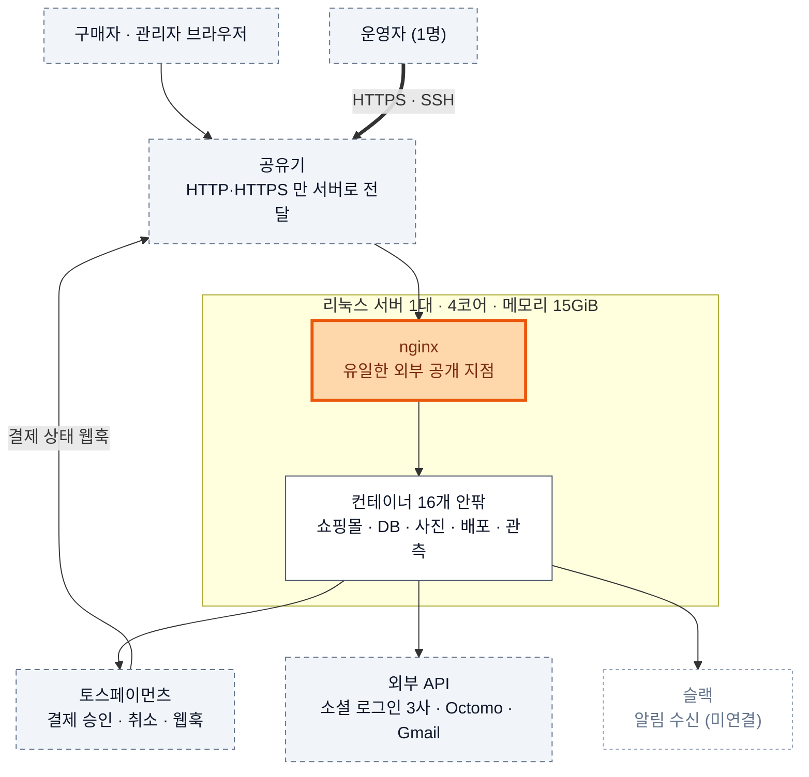
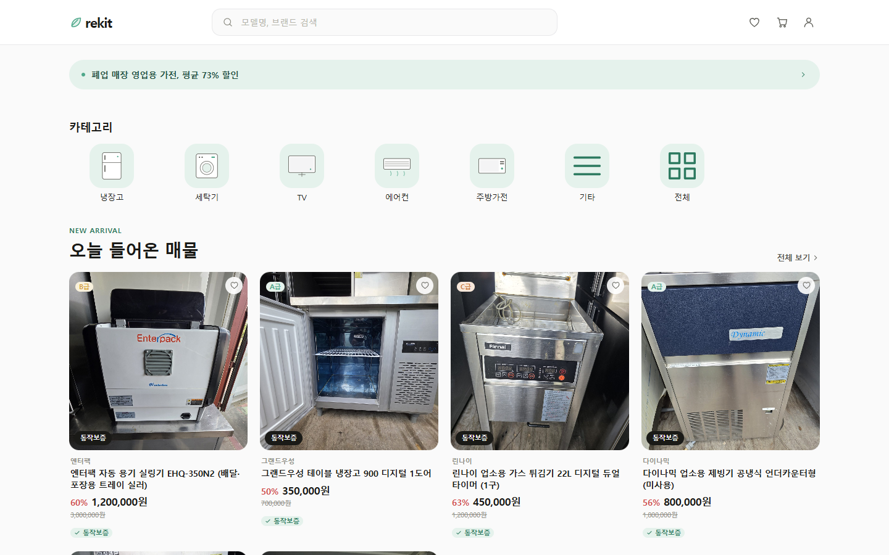
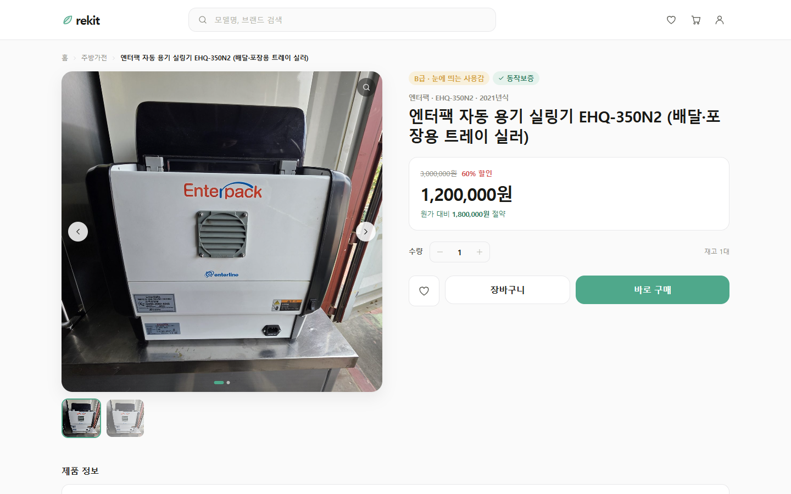
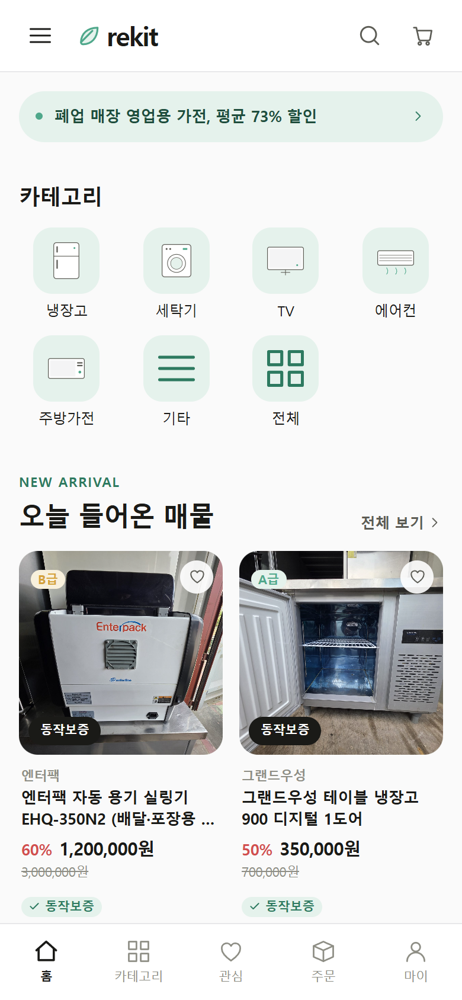

# rekit 소개 문서


**rekit 은 혼자 운영하는 쇼핑몰이 서버 1대 위에서 돈과 재고를 틀리지 않고, 문제가 생기면 보이도록 만든 구조다.**


_들어오는 길은 공유기와 nginx 하나로 모으고, 나머지는 서버 안에서만 서로 닿는다._

## 3문장 요약

1. 폐업 매장 가전을 파는 쇼핑몰을 한 사람이 개발 · 운영하며, 리눅스 서버 1대에 컨테이너 16개 안팎을 올렸다.
2. 재고 1개짜리 상품과 실제 카드 결제를 다루므로, 재고와 결제 상태는 DB 행 잠금과 토스 재조회로만 정한다.
3. 11.05 운영 로그 유실을 계기로 `request_id` · 메트릭 · SLO 알림을 갖췄고, 바깥에 열린 곳을 nginx 하나로 줄였다.

## 숫자로 보기

| 서버 | 컨테이너   | Docker 망            | 외부 공개 지점   | 알림 규칙 | API 경로 | 테스트        |
| -- | ------ | ------------------- | ---------- | ----- | ------ | ---------- |
| 1대 | 16개 안팎 | 주요 4개 + Jenkins 기본망 | 1개 (nginx) | 16개   | 97개    | 746 passed |

## 실제 화면 (2026-11-17 운영 사이트)


{% column width="66%" %}



{% column width="33%" %}




_상세 화면의 "재고 1대"가 이 구조의 출발점이다. 같은 물건이 한 대뿐이라 두 사람이 동시에 사려 할 때 한 명만 성공해야 하고, 그 판정을 어디서 하는지가_ [_앱 구조와 결제_](04-architecture/app.md)_의 주제다._

## 어디부터 읽을까

| 시간이 있다면 | 읽을 장                                                     |
| ------- | -------------------------------------------------------- |
| 1분      | 이 페이지 + [시스템 구성](04-architecture/)의 그림                   |
| 5분      | [문제와 배경](01-background.md) → [주요 설계 결정](05-decisions.md) |
| 전부      | 아래 순서대로                                                  |

| # | 장                                | 한 줄                                    |
| - | -------------------------------- | -------------------------------------- |
| 1 | [문제와 배경](01-background.md)       | 두 달 반 동안 INFO 로그가 한 줄도 남지 않았다          |
| 2 | [요구사항과 제약](02-constraints.md)    | 서버 1대 · 운영자 1명 · 실제 결제가 설계를 정했다        |
| 3 | [핵심 설계 원칙](03-principles.md)     | 여는 곳은 하나, 판정은 DB, 배포는 되돌릴 수 있게, 안은 보이게 |
| 4 | [시스템 구성](04-architecture/)       | 전체 · 컨테이너와 망 · 요청 흐름 · 앱과 결제 · 모니터링    |
| 5 | [주요 설계 결정](05-decisions.md)      | 네 결정의 선택지 · 대가 · 결과                    |
| 6 | [기술 선택 이유](06-tech-choices.md)   | 이유가 기록된 선택만                            |
| 7 | [변경 이력](07-history.md)           | 08.23 → 08.30 → 11.05 → 11.10          |
| 8 | [운영 현황](08-operations.md)        | 확인된 수치와 채울 자리                          |
| 9 | [회고와 남은 과제](09-retrospective.md) | 서버 밖 감시와 백업이 1순위                       |


이 문서는 코드 · 설정 · 커밋 · [작업일지](../rekit-1/)에서 확인한 사실만 쓴다. 확인하지 못한 내용은 `[확인 필요]` 로 표시했고, 포트 · 서버 주소 · 내부 관리 경로는 적지 않는다.

